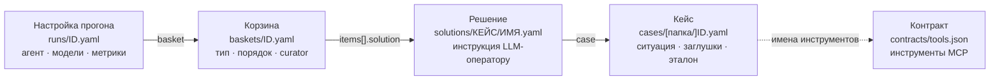
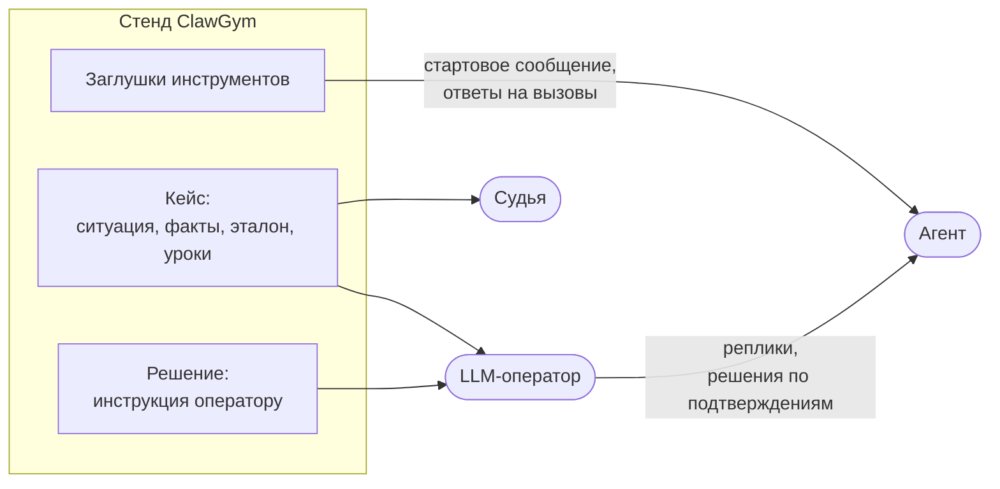
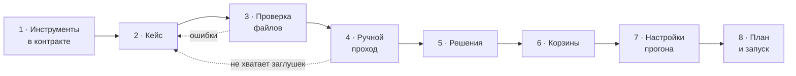

# Руководство: кейсы, решения и корзины

Дата: 28 октября 2026 года. Описывает ClawGym с подсказкой LLM-оператора `operator-v2` и терминальными инструментами.

Как завести обращение для стенда, научить на нём агента и честно проверить результат. Краткий справочник всех файлов настроек — [FORMATS.md](../FORMATS.md). Здесь — подробно, с примерами и рекомендациями, про файлы, из которых собирается любой прогон.

| Страница | О чём |
| --- | --- |
| [Кейсы](cases.md) | Обращение: ситуация, факты, заглушки инструментов, эталон и уроки |
| [Решения](solutions.md) | Сценарий LLM-оператора для кейса: как он помогает агенту |
| [Корзины](baskets.md) | Упорядоченный набор решений: обучение или проверка, `/skill-curator`, лимиты |
| [Шпаргалка](cheatsheet.md) | Все поля на одной странице, сообщения проверки файлов и что с ними делать |

Пути вида `cases/…`, `baskets/…` считаются от каталога справочников `config/` (`CLAWGYM_CONFIG`).

## Как связаны файлы



| Файл | Отвечает на вопрос | Ссылается на |
| --- | --- | --- |
| **Кейс** | Что за обращение, что вернут инструменты и как его правильно решить? | Инструменты контракта — по имени |
| **Решение** | Как LLM-оператор ведёт себя в этом кейсе? | Кейс — полем `case` |
| **Корзина** | Какие решения, в каком порядке, учится ли агент? | Решения — полем `items[].solution` |
| **Настройка прогона** | На каком агенте и моделях гонять корзину и сколько раз? | Корзину, агента, модели, метрики |

Главные правила:

- **Кейс — один, решений — много.** Заглушки и эталон живут в кейсе и общие для всех его решений. Решение хранит только поведение оператора.
- **Корзина состоит из решений, а не из кейсов.** Один кейс может войти в корзину несколько раз — с разными решениями или с одним и тем же.
- **Тип прогона задаёт корзина.** Обучающая (`training`) меняет скиллы тестового оператора, проверяющая (`checking`) — нет. Смешивать их в одной корзине нельзя.
- **Ссылки — по идентификаторам.** Кейс можно перенести в другую папку `cases/` — ссылки не сломаются. У решения идентификатор по умолчанию — путь файла: при переносе решения поправьте корзины ([подробнее](solutions.md#файл-и-идентификатор)).

## Кто что видит

Агент знает об обращении только то, что ClawGym ему отправил. Эталон и сценарий оператора остаются на стенде.



| Кто | Что получает |
| --- | --- |
| **Агент** | Стартовое сообщение (оно собирается из ответов заглушек), ответы заглушек на свои вызовы, реплики оператора, служебные команды. В обучении — ещё тематику кейса в `/case-capture` |
| **LLM-оператор** | Ситуацию, факты, эталон, каталог уроков, инструкцию решения, режим корзины и журнал диалога |
| **Судья по критериям** | Ситуацию, факты, процедуру, ответ, критерии и итог: реплики агента и его вызовы без ответов инструментов |
| **Судья по эталонному тексту** | Эталонный итоговый текст и итоговый текст агента — для метрики A_judge |

Подробная таблица по каждому полю — [Кейсы → Кто что видит](cases.md#кто-что-видит).

## От идеи до прогона

1. **Проверьте инструменты.** Все инструменты, которые понадобятся агенту, должны быть в `contracts/tools.json`. Там же видно, какие требуют подтверждения оператора (`requiresConfirmation`) и какие закрывают кейс (`terminal`).
2. **Напишите кейс** в `cases/` — [Кейсы](cases.md). Начните с копии похожего кейса из `config/cases/`.
3. **Проверьте файлы:** `npm run validate` или «Кейсы и решения» → «Перечитать файлы». Откройте кейс и разверните «Стартовое сообщение — как его получит агент».
4. **Пройдите кейс вручную:** «Пройти вручную» на странице кейса. Так видно, хватает ли заглушек. Ответ человека вместо инструмента даёт готовый YAML-фрагмент для кейса.
5. **Напишите решения** в `solutions/<кейс>/` — [Решения](solutions.md). Обычно нужны хотя бы одно обучающее и одно «Только факты» для проверки.
6. **Соберите корзины** в `baskets/` — [Корзины](baskets.md): обучающую и проверяющую.
7. **Заведите настройки прогона** в `runs/` по схеме «проверка → обучение → та же проверка на обученном операторе».
8. **Посмотрите план** до запуска: «Запуск прогона» или `node dist/src/cli.js preview <настройка>`.



## Где что лежит

```text
config/                          каталог справочников, CLAWGYM_CONFIG
├── contracts/
│   ├── tools.json               инструменты MCP, подтверждения, терминальные инструменты
│   ├── start-message.txt        шаблон стартового сообщения
│   └── tool-defaults.yaml       заглушки по умолчанию для всех кейсов
├── cases/                       кейсы; подкаталоги любой глубины
│   ├── spasibo-bonus-missing.yaml
│   └── cards/                   пример папки: на ссылки не влияет
│       └── card-hold-amount.yaml
├── solutions/                   решения: solutions/<кейс>/<имя>.yaml
│   └── card-hold-amount/
│       ├── explain-now.yaml
│       └── facts-only.yaml
├── baskets/                     корзины; только файлы в корне каталога
│   ├── second-line-train.yaml
│   └── second-line-check.yaml
├── runs/                        настройки прогонов
└── data/                        файлы ответов заглушек (result.file), если нужны
```

Файл или папка с именем на `_` не загружаются: так откладывают черновики, например `cases/_черновики/`. Файлы читаются с расширениями `.yaml`, `.yml` и `.json`.

## Проверка файлов

Сначала один раз соберите проект, затем проверяйте справочники без запуска сервиса:

```bash
npm run build
```

```bash
npm run validate
```

Ошибка указывает файл, строку, поле и причину; предупреждение не мешает запуску. Пример вывода:

```text
ОШИБКА  cases/cards/mini.yaml:8 · tools.get_card_history[1]
         В одном ответе заданы и result, и error
внимание cases/cards/mini.yaml · reference.tools
         Нет эталонного набора инструментов (reference.tools): F1 инструментов и M2 для кейса не посчитаются

Файлов: 41 · кейсов 5 · решений 10 · корзин 8 · прогонов 6 · ошибок 9
```

- **В интерфейсе** — «Перечитать файлы» на странице «Кейсы и решения» или «Проверить файлы снова» на «Запуске прогона». Через API — `POST /api/config/reload` с заголовком `Content-Type: application/json`.
- **План прогона** без запуска — `node dist/src/cli.js preview <настройка>`: порядок команд, доступность метрик и ошибки всех файлов, которые войдут в прогон.
- **Идущий прогон** работает со снимком файлов, сделанным при запуске. Правка кейса или корзины его не меняет.

Что означает каждое сообщение и как его исправить — [Шпаргалка → Сообщения проверки](cheatsheet.md#сообщения-проверки-файлов).

## Словарь

| Термин | Значение |
| --- | --- |
| Кейс | Обращение клиента с заглушками инструментов и эталоном решения |
| Решение | Сценарий LLM-оператора для одного кейса |
| Корзина | Упорядоченный список решений одного типа: обучающий или проверяющий |
| Прогон | Запуск корзины по настройке из `runs/` на агенте с выбранными моделями |
| Линия | Одно повторение корзины в прогоне, со своим тестовым оператором |
| Тестовый оператор | `x-a2a-sender-id`, у которого в агенте живут скиллы: стартовые от сборки и выученные |
| LLM-оператор | Модель, которая играет сотрудника второй линии: отвечает агенту и решает по подтверждениям |
| Судья | Отдельная модель оценки: проверяет ответ агента по критериям и сравнивает итоговый текст с эталонным |
| Заглушка | Заранее заданный ответ инструмента MCP на вызов агента |
| Эталон | Правильная процедура, ответ, критерии, обязательные и запрещённые действия кейса |
| Урок | Правило из каталога кейса, на которое ссылается поправка оператора |
| Поправка | Реплика или отклонение действия, которые исправляют агента; размечается уроком |
| Подтверждение | Удержание вызова инструмента до решения оператора: разрешить или отклонить |
| Терминальный инструмент | Инструмент, выполненный вызов которого закрывает кейс, например `get_close_with_answer` |
