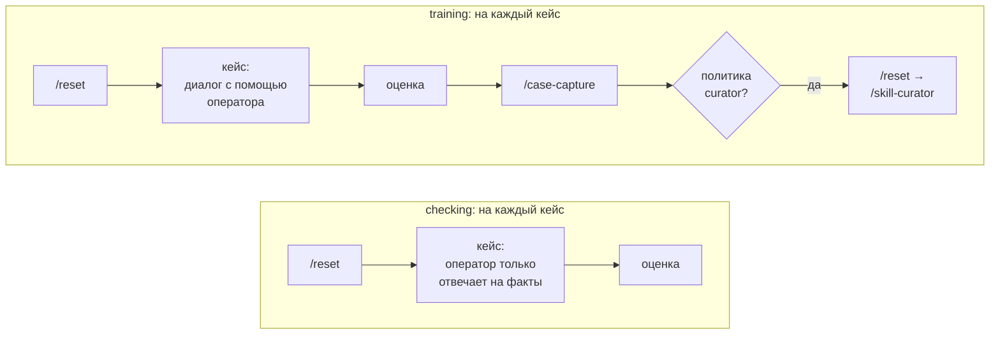
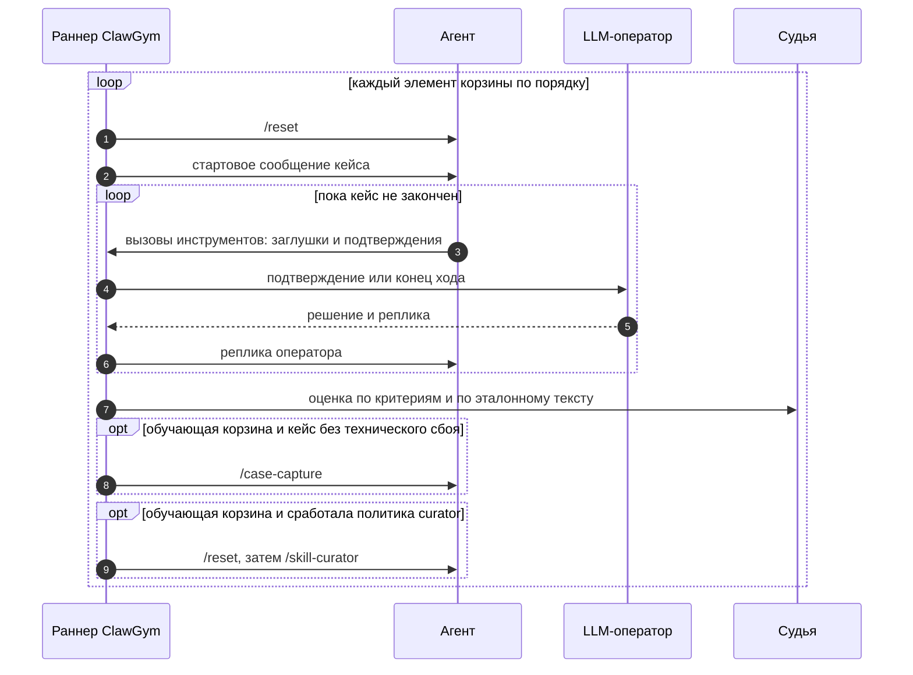
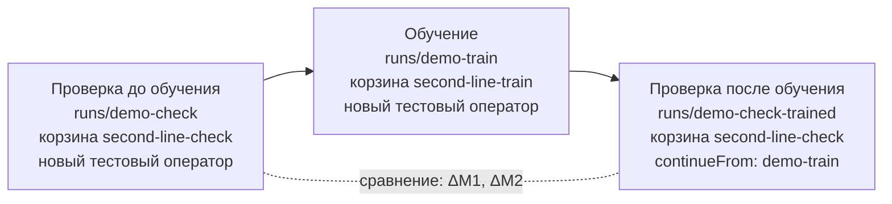

# Корзины

[← Руководство](README.md) · [Кейсы](cases.md) · [Решения](solutions.md) · **Корзины** · [Шпаргалка](cheatsheet.md)

Корзина — упорядоченный список решений одного типа. Тип определяет, учится ли агент во время прогона: обучающая корзина отправляет агенту `/case-capture` и `/skill-curator`, проверяющая — нет. Смешивать обучение и проверку в одной корзине нельзя: для схемы «до и после» заводят две корзины.

**На странице:** [типы](#два-типа-корзин) · [файл](#файл-и-идентификатор) · [формат](#формат) · [состав](#состав) · [curator](#политика-curator) · [подтверждения в проверке](#подтверждения-в-проверке) · [выполнение](#как-корзина-выполняется) · [план команд](#план-команд) · [корзина в прогоне](#корзина-в-прогоне) · [сравнение](#сравнение-до-и-после) · [рекомендации](#рекомендации) · [примеры](#примеры) · [чек-лист](#чек-лист-корзины)

## Два типа корзин

| | `training` — обучающая | `checking` — проверяющая |
| --- | --- | --- |
| Зачем | Научить тестового оператора: поправки → `/case-capture` → `/skill-curator` | Измерить, что умеют скиллы тестового оператора |
| `/reset` перед кейсом | да | да |
| `/case-capture` после кейса | После каждого завершённого, даже решённого неверно. После технического сбоя — нет | никогда |
| `/skill-curator` | По блоку `curator` и явным шагам | Никогда: блок с проходами и шаги `curator` — ошибка |
| LLM-оператор | Помогает по инструкции решения, размечает поправки | Отвечает только на вопросы о фактах; поправки запрещены |
| Подтверждения | Решает оператор | `approve` — автоматически; `operator` — оператор, без поправок |
| Скиллы тестового оператора | Меняются | Не меняются |
| Метрики поправок | Считаются | «в проверке поправок нет» |



## Файл и идентификатор

- **Где лежит:** `baskets/<id>.yaml` (или `.yml`, `.json`) — **только в корне** `baskets/`. Файлы в подкаталогах не читаются, и проверка об этом не предупреждает.
- **Черновики:** файл с именем на `_` не загружается.
- **`id`** — латиница, цифры и `. _ / -`, первый символ — буква или цифра; уникален среди корзин. На совпадение с именем файла не проверяется, но держите их одинаковыми: интерфейс показывает имя файла, а настройки прогона ссылаются на `id`.
- **`id` попадает в `x-a2a-sender-id`** нового тестового оператора: `lab-<id корзины>-r<прогон>-<линия>-<хвост>`, например `lab-second-line-train-r12-1-a1b2c3`. Поэтому `id` короткий, латиница с дефисами, без `/`.
- **В интерфейсе** на странице «Корзины» видно, какие файлы прогонов используют корзину, и её последний прогон.

## Формат

```yaml
id: second-line-mini-train            # обязательно; совпадает с именем файла
title: Обучение · вторая линия · три кейса     # обязательно
type: training                        # обязательно: training | checking
description: >                        # зачем корзина и как устроена
  Три кейса по одному разу, сценарий «Объясняет сразу». Curator после каждых
  двух завершённых решений и финальный проход — после третьего.
curator:                              # только training
  every: 2                            # проход после каждых N завершённых кейсов; 0 — без периодических
  final: true                         # проход в конце, если последняя пачка неполная
  resetBefore: true                   # /reset перед /skill-curator; по умолчанию да
items:                                # обязательно; фиксированный порядок
  - solution: spasibo-bonus-missing/explain-now
  - solution: card-operation-dispute/explain-now
    limits: { maxTurns: 12 }          # лимиты только этого элемента
  - solution: card-hold-amount/explain-now
  # - curator: true                   # явный шаг curator — только training; не сразу за периодическим проходом
  #   note: после первой пары тематик # заметка к шагу
```

| Поле | Обязательно | По умолчанию | Значение |
| --- | --- | --- | --- |
| `id` | да | — | Идентификатор корзины |
| `title` | да | — | Название в списках, при запуске и в сравнении |
| `type` | да | — | `training` или `checking` |
| `description` | нет | пусто | Пояснение на странице «Корзины» |
| `curator.every` | нет | `0` | Проход после каждых N завершённых кейсов, 0–1000; `0` — без периодических |
| `curator.final` | нет | `false` | Дополнительный проход в конце, если с последнего прохода остались кейсы |
| `curator.resetBefore` | нет | `true` | `/reset` перед `/skill-curator`, как в `INTEGRATION.md` |
| `curator.enabled` | нет | `true`, если блок задан | `false` — выключить периодические и финальный проходы, не удаляя блок. Явные шаги остаются |
| `checking.confirmations` | нет | `approve` | Только checking: `approve` или `operator` — [подробнее](#подтверждения-в-проверке) |
| `items` | да | — | Элементы по порядку; хотя бы одно решение |
| `items[].solution` | — | — | Идентификатор решения: `<кейс>/<имя>` |
| `items[].curator` | — | — | Явный шаг curator: `curator: true` |
| `items[].limits` | нет | — | `maxTurns`, `maxDurationSec`, `maxOperatorCalls` этого элемента |
| `items[].note` | нет | — | Заметка. В интерфейсе видна у шага curator; к решениям пишите YAML-комментарий |

Ошибки проверки файлов:

- элемент и с `solution`, и с `curator` — или ни с тем, ни с другим;
- в корзине нет ни одного решения;
- решения с таким идентификатором нет в `solutions/`;
- в проверяющей корзине блок `curator` с `every` больше нуля или `final: true` — либо шаг `curator`.

Блок `checking` в обучающей корзине — предупреждение: он ни на что не влияет.

## Состав

- **Порядок фиксирован** и одинаков для каждой линии прогона. Перемешивания нет.
- **Решение может повторяться**, а один кейс — входить с разными решениями. В демо кейс СберСпасибо идёт в обучении трижды: «Объясняет сразу», «Объясняет по вопросу», «Помогает минимально».
- **Каждый элемент — отдельное выполнение:** перед ним `/reset`, у него своё состояние заглушек и счётчики последовательностей.
- **Позиции считаются только по решениям**, шаги curator их не получают. Выполнение называется `L<линия>-P<позиция>`, например `L1-P03`, номер обращения — `CG-<прогон>-<позиция>`.
- **Кейс для ручного прохода в корзину не кладут:** в автоматическом прогоне вызов без заглушки сразу получает ошибку.

## Политика curator

`/skill-curator` переносит уроки, собранные `/case-capture`, в выученные скиллы тестового оператора. Когда его запускать, задают блок `curator` и явные шаги.

**Счётчик curator** — число кейсов, завершённых с нетехническим статусом после прошлого прохода. Исчерпанный лимит — тоже завершение. Технический сбой: `/case-capture` не отправляется, счётчик не растёт. Неудачный `/case-capture` счётчик не уменьшает.

| Правило | Когда срабатывает |
| --- | --- |
| `every: N` | Счётчик дошёл до N: проход, счётчик в ноль |
| `final: true` | Корзина кончилась, а счётчик не нулевой: финальный проход |
| `- curator: true` | Явный шаг на своём месте в `items`: проход, счётчик в ноль. Выполняется всегда — и без блока `curator`, и при `enabled: false`, даже если с прошлого прохода не было ни одного кейса |
| `resetBefore: true` | Перед каждым проходом — `/reset`. Если он не удался, проход не выполняется, счётчик обнуляется |
| `enabled: false` или блока нет | Периодических и финального проходов нет. Явные шаги выполняются |

**Как это выглядит на демо-корзине** `second-line-train` — 7 решений, `every: 2`, `final: true`:

| Позиция | Решение | Счётчик после кейса | Дальше |
| ---: | --- | :---: | --- |
| 1 | `spasibo-bonus-missing/explain-now` | 1 | — |
| 2 | `card-operation-dispute/explain-now` | 2 | `/reset` → `/skill-curator` 1, счётчик 0 |
| 3 | `spasibo-bonus-missing/explain-on-ask` | 1 | — |
| 4 | `card-operation-dispute/explain-on-ask` | 2 | `/skill-curator` 2 |
| 5 | `spasibo-bonus-missing/minimal` | 1 | — |
| 6 | `card-operation-dispute/minimal` | 2 | `/skill-curator` 3 |
| 7 | `card-hold-amount/explain-now` | 1 | Корзина кончилась, счётчик 1: финальный `/skill-curator` 4 |

Если бы кейс 3 упал технически, счётчик после кейса 4 был бы 1, и второй проход случился бы только после кейса 5.

**Варианты политики** для корзины из пяти решений:

| Задача | Настройка | Проходы `/skill-curator` |
| --- | --- | --- |
| Только `/case-capture`, без curator | блока `curator` нет | нет |
| После каждого кейса | `curator: { every: 1 }` | после 1, 2, 3, 4, 5 |
| Пачками и хвост | `curator: { every: 2, final: true }` | после 2, 4 и финальный после 5 |
| Один раз в конце | `curator: { every: 0, final: true }` | финальный после 5 |
| В заданных местах | шаги `- curator: true`; блок `curator` не нужен | на месте каждого шага |

> [!WARNING]
> **Явный шаг не смотрит на счётчик.** С `every` больше нуля его легко поставить сразу за периодическим проходом. Тогда будет два `/skill-curator` подряд, и второму нечего разбирать. Явные шаги проще всего держать без периодических проходов.

> [!TIP]
> **Как часто запускать curator.** По `INTEGRATION.md` каждое сохранённое обращение с поправкой сразу становится свежим уроком, который агент видит в начале следующего обращения. Поэтому curator не обязан быть частым: его задача — переносить уроки в learned skills. Оркестратору рекомендован проход после 5 и более сохранённых кейсов с сильным или средним сигналом. Агент показывает не больше 10 свежих уроков (`LEARN_LESSONS_MAX`): если поправок между проходами больше, старые перестают показываться. Отсюда правила для корзины:
>
> - `every: 5` близко к политике оркестратора; в коротких корзинах — меньше, как `every: 2` в демо;
> - между проходами — не больше 10 поправок;
> - `final: true`, если после обучения идёт проверка: уроки последних кейсов попадут в скиллы, а не останутся только свежими уроками.

## Подтверждения в проверке

| | `approve` — по умолчанию | `operator` |
| --- | --- | --- |
| Кто решает | ClawGym разрешает вызов сам, модель оператора не вызывается | LLM-оператор, без поправок и объяснений |
| Ошибочное действие агента | Выполняется: проверки действий и M1 видят настоящий выбор агента | Оператор может отклонить — дальше агент идёт по другому пути |
| Терминальный инструмент | Закрывает кейс сразу | Закрывает кейс после разрешения |
| Лимит `maxOperatorCalls` | Подтверждения в него не входят | Входят |
| Когда выбирать | Тестовый датасет, сравнение M1 и M2 до и после обучения | Когда нужен оператор, который не даёт выполнить неверное действие, но и не учит |

## Лимиты

Лимиты кейса берутся с самого частного уровня: элемент корзины → решение → настройка прогона → по умолчанию 20 ходов, 900 секунд и 30 запросов оператора. В корзине задавайте лимит, когда он нужен именно этой позиции; лимит, нужный стратегии, — в решении. Подробно — [Решения → Лимиты](solutions.md#лимиты).

## Как корзина выполняется

Каждая линия прогона проходит корзину целиком на своём тестовом операторе:



- **Следующий шаг — только после ответа на предыдущий.** У оператора один диалог с агентом: кейсы и команды идут в него по очереди.
- **Сбой одного кейса не останавливает линию:** кейс получает технический статус, остальные идут дальше. Исключение — агент не освободил сессию после прерванного запроса: линия останавливается, оставшиеся кейсы получают «Не начат» с причиной.
- **Линии идут параллельно** в пределах `MAX_PARALLEL_SESSIONS` стенда, по умолчанию 2; остальные ждут свободной сессии. Если повторений больше, чем `sessions.max` в подключении агента, при запуске будет предупреждение.

## План команд

План строится до запуска и сохраняется в результате. Его видно:

- на странице «Корзины» — разделы «Команды», «План команд» и «Состав · фиксированный порядок»;
- на «Запуске прогона» — вместе с тестовым оператором и доступностью метрик;
- в командной строке:

```bash
node dist/src/cli.js preview demo-train
```

```text
План команд:
  /reset → кейс 1 (spasibo-bonus-missing/explain-now) → /case-capture
  /reset → кейс 2 (card-operation-dispute/explain-now) → /case-capture
  /skill-curator 1
  /reset → кейс 3 (spasibo-bonus-missing/explain-on-ask) → /case-capture
  /reset → кейс 4 (card-operation-dispute/explain-on-ask) → /case-capture
  /skill-curator 2
  /reset → кейс 5 (spasibo-bonus-missing/minimal) → /case-capture
  /reset → кейс 6 (card-operation-dispute/minimal) → /case-capture
  /skill-curator 3
  /reset → кейс 7 (card-hold-amount/explain-now) → /case-capture
  /skill-curator 4 (финальный)
  · /reset перед каждым кейсом, следующий шаг — только после успешного ответа.
  · /case-capture после каждого завершённого кейса, в том числе решённого неверно.
  · /skill-curator каждые 2 завершённых решения: после 2-го, после 4-го, после 6-го, финальный после 7-го.
  · Перед /skill-curator отправляется /reset, как в INTEGRATION.md.
  · Если кейс прерван технически, capture не отправляется и кейс не входит в счётчик curator.
```

План — расписание при условии, что все кейсы завершатся. Технический сбой сдвигает проходы, как в примере выше.

## Корзина в прогоне

Корзину запускает настройка прогона в `runs/`. Тип прогона берётся из корзины.

```yaml
id: cards-train
title: Обучение · карты · fake-agent
basket: cards-train                   # id корзины
agent: fake-agent
models:
  operator: fake-operator             # обязательно для автоматического прогона
  judge: fake-judge                   # без неё ответы останутся «не оценены»
# repetitions: 3                      # линии, у каждой свой тестовый оператор
```

Схема аналитика — три прогона на двух корзинах:



- Проверка «до» идёт на новом тестовом операторе со стартовыми скиллами сборки агента.
- Обучение — тоже на новом операторе; выученное остаётся у него в агенте.
- Проверка «после» — та же проверяющая корзина на операторе обучения: `continueFrom` берёт последний завершённый или остановленный прогон указанной настройки. Число повторений — не больше числа линий обучения: линия N продолжает линию N.

На стенде то же самое — `stand-check` → `stand-train` → `stand-check-trained`.

## Сравнение «до» и «после»

Сравнение сверяет полный SHA-256 каждого входного файла, и корзина с кейсами — отдельные строки:

- **«Корзина»** — файл корзины;
- **«Кейсы и решения»** — файлы решений, кейсов и их файлов ответов из `data/`.

Прогоны сопоставимы, только если отличается один тестовый оператор. Кейсы сравниваются по позиции: на позиции должно стоять то же решение, иначе позиция не сравнивается. Сравнивается первая линия каждого прогона; при меньше чем трёх повторениях сравнение предупредит, что разницу нельзя считать статистически значимой.

> [!IMPORTANT]
> **Заморозьте проверяющую корзину на всю серию.** Не меняйте её состав и порядок, кейсы и решения между проверкой «до» и «после». Любая правка — даже опечатка в критерии — делает прогоны несопоставимыми. Нужно поправить — начните серию заново с проверки «до».

## Рекомендации

### Проверяющая корзина — тестовый датасет

- **Неизменна на всю серию** «до → обучение → после».
- **Решения «Только факты»** (`facts-only`) и `confirmations: approve`: агент решает сам, M1 видит его настоящий финал.
- **Разные исходы до обучения.** Включайте кейсы, где агент со стартовыми скиллами ошибается, — на них видно обучение, — и кейсы, где он прав, — на них видны регрессии. В демо обучение видно по `card-hold-amount`: M1 0,73 → 1,00.
- **Обобщение, а не память.** Кроме кейсов из обучения, добавьте кейсы тех же тематик с другими данными, которых в обучении не было: так видно, усвоено ли правило, а не конкретное обращение.
- **Один кейс — один элемент.** M1 и M2 усредняются по элементам: повтор кейса удваивает его вес.
- **Большая проверка — это часы.** Корзина идёт последовательно на одной линии, а проверка «после» — на одном обученном операторе. Ставьте её на ночь: `startAt` в настройке прогона.

### Обучающая корзина

- **Чередуйте тематики и стратегии**, как в демо: СберСпасибо и оспаривание по очереди, затем следующая стратегия. Между повторами одного кейса агент решает другие обращения — так видно, держится ли урок.
- **Одно правило — в нескольких кейсах.** С общим идентификатором урока метрика «Повторные поправки» покажет, усвоил ли агент правило с первого раза.
- **От объяснений к самостоятельности:** сначала «Объясняет сразу», потом «По вопросу» и «Минимально» — так видно, держится ли выученное без подсказок.
- **`final: true`** перед проверкой «после».
- **`description`** объясняет замысел и расписание curator — его читают на странице корзины и при разборе.

### Общее

- **Пары с понятными именами:** `<область>-train` и `<область>-check`, названия «Обучение · …» и «Проверка · …».
- **Сначала маленькая корзина.** Новый кейс отлаживайте в корзине из одного-двух элементов, потом добавляйте в большую.
- **Только корень `baskets/`.** Корзина в подкаталоге молча не загрузится.
- **Посмотрите план** на странице «Корзины» или в `preview` перед каждым новым прогоном.

## Примеры

<details>
<summary><b>Обучающая корзина</b> — <code>baskets/second-line-train.yaml</code></summary>

```yaml
id: second-line-train
title: Обучение · СберСпасибо и операции по картам
type: training
description: Три кейса, три сценария помощи. Curator каждые 2 завершённых решения и финальный проход неполной пачки — после седьмого.
curator:
  every: 2
  final: true
  resetBefore: true
items:
  - solution: spasibo-bonus-missing/explain-now
  - solution: card-operation-dispute/explain-now
  - solution: spasibo-bonus-missing/explain-on-ask
  - solution: card-operation-dispute/explain-on-ask
  - solution: spasibo-bonus-missing/minimal
  - solution: card-operation-dispute/minimal
  # Блокировка суммы: исходный скилл выставляет экспертизу, оператор отклоняет и объясняет правило.
  - solution: card-hold-amount/explain-now
```

</details>

<details>
<summary><b>Проверяющая корзина</b> — <code>baskets/second-line-check.yaml</code></summary>

```yaml
id: second-line-check
title: Проверка · СберСпасибо и операции по картам
type: checking
description: Проверка текущих скиллов без обучения. Третий элемент — сценарий с обучающими поправками; в проверке они не исполняются. Четвёртый различает версии по M1 — классу финального действия.
checking:
  confirmations: approve
items:
  - solution: spasibo-bonus-missing/facts-only
  - solution: card-operation-dispute/facts-only
  - solution: spasibo-bonus-missing/explain-on-ask
  - solution: card-hold-amount/facts-only
```

Третий элемент демонстрирует защиту режима: обучающий сценарий в проверке не исполняется. В рабочем датасете так не делают — там только «Только факты».

</details>

<details>
<summary><b>Явные шаги curator</b> — проход после каждой тематики</summary>

```yaml
id: cards-train-by-topic
title: Обучение · карты · curator после каждой тематики
type: training
description: Сначала оспаривание, затем блокировка суммы; curator — только явными шагами, после каждой тематики.
items:                                # блока curator нет: периодических проходов нет, явные шаги выполняются
  - solution: card-operation-dispute/explain-now
  - solution: card-operation-dispute/explain-on-ask
  - curator: true
    note: после оспаривания
  - solution: card-hold-amount/explain-now
  - curator: true
    note: после блокировки суммы
```

</details>

<details>
<summary><b>Дымовая корзина</b> — быстрая проверка нового кейса</summary>

```yaml
id: smoke-card-hold
title: Проверка · дымовая · блокировка суммы
type: checking
description: Один кейс с короткими лимитами — убедиться, что заглушки и стартовое сообщение работают.
items:
  - solution: card-hold-amount/facts-only
    limits: { maxTurns: 8, maxDurationSec: 300 }
```

</details>

## Чек-лист корзины

- [ ] Файл в корне `baskets/`, `id` совпадает с именем файла, короткий и без `/`
- [ ] `type` выбран осознанно: обучение меняет скиллы оператора, проверка — нет
- [ ] `title` и `description` объясняют замысел
- [ ] Все `items[].solution` существуют; порядок — тот, что нужен эксперименту
- [ ] Training: частота curator — блоком `curator` или явными шагами — согласована с числом поправок; перед проверкой есть проход в конце
- [ ] Training с явными шагами: ни один не стоит сразу за периодическим проходом
- [ ] Checking: решения «Только факты», `confirmations: approve`, без `curator`
- [ ] Кейсы корзины не рассчитаны на ответы человека вместо заглушек
- [ ] План на странице «Корзины» или в `preview` совпадает с ожиданием
- [ ] Проверяющая корзина заморожена на всю серию «до → обучение → после»
