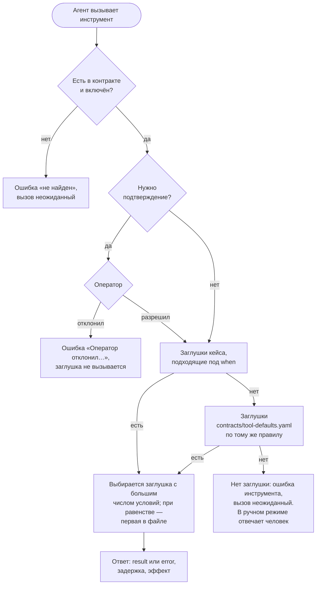
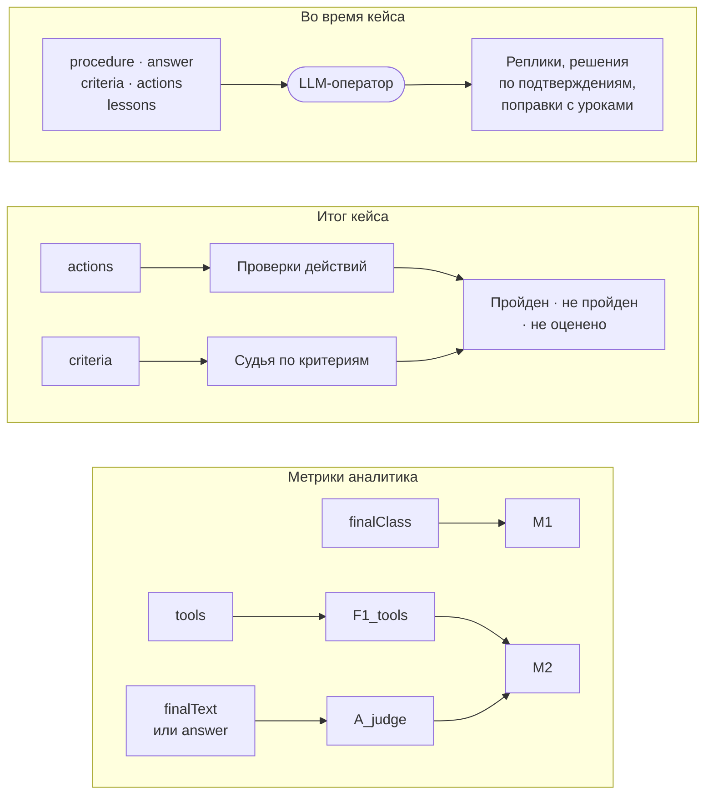
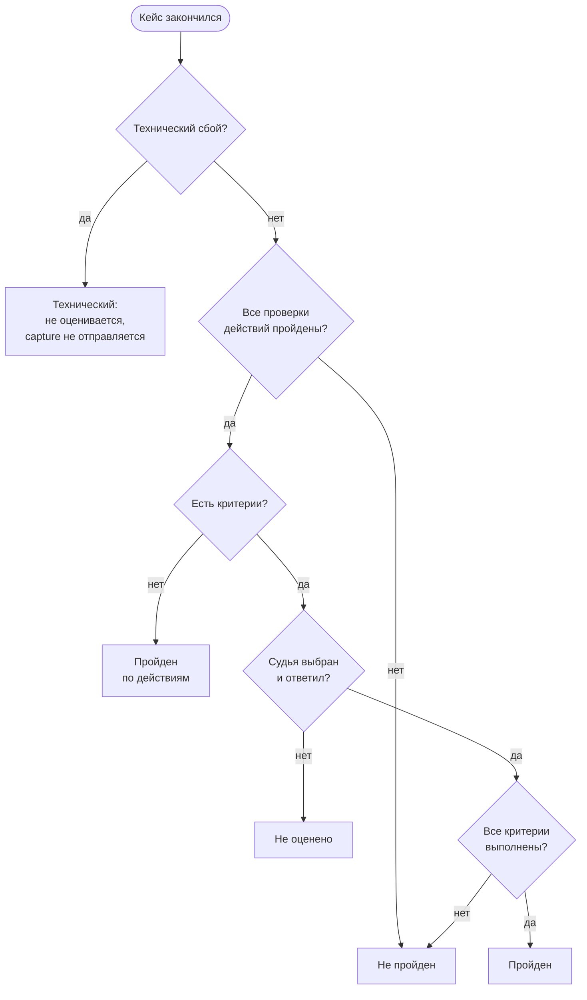

# Кейсы

[← Руководство](README.md) · **Кейсы** · [Решения](solutions.md) · [Корзины](baskets.md) · [Шпаргалка](cheatsheet.md)

Кейс — одно обращение клиента в виде, удобном стенду: что случилось на самом деле, что вернут инструменты, как правильно решить и по каким признакам судить ответ. Поведения оператора в кейсе нет: оно в [решениях](solutions.md). Поэтому один кейс — с одними заглушками и эталоном — можно пройти с разными сценариями помощи.

**На странице:** [файл и идентификатор](#файл-и-идентификатор) · [кто что видит](#кто-что-видит) · [минимальный и полный кейс](#минимальный-и-полный-кейс) · [карточка](#карточка-кейса) · [ситуация и факты](#ситуация-факты-и-стартовые-данные) · [заглушки](#заглушки-инструментов) · [эталон](#эталон) · [завершение и оценка](#как-кейс-завершается-и-оценивается) · [ручной режим](#кейс-для-ручного-режима) · [рекомендации](#рекомендации) · [как не надо](#как-не-надо) · [чек-лист](#чек-лист-кейса)

## Из чего состоит кейс

```yaml
# ── Карточка ────────────────────────────────────────────────
id: card-hold-amount                # совпадает с именем файла
title: Сумма по карте заблокирована, но не списана
topic: Карты / Блокировка суммы     # точное название тематики
tags: [Карты, Блокировка]
# ── Для оператора и судьи: агенту не передаётся ─────────────
situation: >                        # что произошло на самом деле
  …
facts: [ … ]                        # что оператор может сообщить по вопросу
start: {}                           # поля {{start.*}} для шаблона старта
# ── Выполнение ──────────────────────────────────────────────
state: { case: open }               # начальное состояние, его меняют эффекты
tools: { … }                        # заглушки: что вернут инструменты
# ── Эталон: агенту не передаётся ────────────────────────────
reference:
  procedure: [ … ]                  # правильная процедура
  answer: …                         # правильный ответ клиенту
  criteria: [ … ]                   # критерии для судьи
  actions: { required, forbidden, final }   # автоматические проверки
  lessons: [ … ]                    # каталог уроков
  finalClass: close_answer          # M1: класс финального действия
  tools: [ … ]                      # M2: эталонный набор инструментов
  finalText: …                      # M2: эталонный итоговый текст
```

## Файл и идентификатор

- **Где лежит:** `cases/<id>.yaml` или в подкаталогах любой глубины: `cases/cards/disputes/<id>.yaml`. Расширения — `.yaml`, `.yml`, `.json`.
- **`id` совпадает с именем файла** без расширения, иначе предупреждение. Папка в идентификатор не входит.
- **`id` уникален во всём `cases/`.** Один `id` в двух папках — ошибка с указанием обоих файлов.
- **Допустимые символы:** латиница, цифры и `. _ / -`; первый символ — буква или цифра. Кириллица в идентификаторе — ошибка.
- **Черновики:** файл или папка с именем на `_` не загружаются, например `cases/_черновики/`.
- **Ссылки — по `id`.** Решения ссылаются на кейс полем `case`, поэтому кейс можно переносить между папками, ничего не правя.
- **В интерфейсе** «Кейсы и решения» группирует кейсы по папкам, ищет и по имени папки, рядом с папкой — число кейсов.

> [!TIP]
> Называйте кейс по проблеме клиента, а не по ожидаемому решению: `card-hold-amount`, а не `card-hold-close-answer`. Короткий kebab-case читается в журналах и в номерах выполнений. Папки удобно заводить по тематикам: `cases/spasibo/`, `cases/cards/`.

## Кто что видит

Агент получает только стартовое сообщение, ответы заглушек, реплики оператора и служебные команды. Всё остальное в кейсе — для стенда.

| Поле | Агент | LLM-оператор | Судья по критериям | Судья по эталонному тексту | Ещё используется |
| --- | --- | --- | --- | --- | --- |
| `id`, `title` | если шаблон старта содержит `{{case.id}}`, `{{case.title}}` | да | да | да | интерфейс, результаты |
| `topic` | в `/case-capture` обучающей корзины; в старте — если есть в шаблоне | да | да | да | — |
| `tags` | если есть в шаблоне старта | — | — | — | поиск в интерфейсе |
| `situation`, `facts` | — | да | да | — | — |
| `start` | если шаблон старта содержит `{{start.*}}` | да | да | — | страница кейса |
| `state` | через `{{state.*}}` в ответах заглушек | — | — | — | журнал выполнения |
| `tools` | стартовое сообщение и ответы на свои вызовы | вызовы; ответы — если `seesToolResults` не `false` | вызовы и их исход, без ответов | — | журнал, «неожиданные инструменты» |
| `reference.procedure` | — | да | да | — | — |
| `reference.answer` | — | да | да | эталон, если нет `finalText` | — |
| `reference.criteria` | — | да | да | — | итог кейса |
| `reference.actions` | — | да, без `args` | — | — | проверки действий, итог кейса |
| `reference.lessons` | — | да | — | — | поправки и повторные поправки |
| `reference.finalClass` | — | — | — | вид эталонного текста | M1 |
| `reference.tools` | — | — | — | — | F1_tools и M2 |
| `reference.finalText` | — | — | — | да | A_judge и M2 |

> [!IMPORTANT]
> Ситуацию, факты и эталон агент не видит. Всё, что он должен узнать о клиенте и обращении, кладите в ответы заглушек — из них же собирается стартовое сообщение.

## Минимальный и полный кейс

### Минимальный

Обязательны только три поля:

```yaml
id: card-test
title: Минимальный кейс
topic: Карты / Тест
```

Такой файл загрузится, но проверка даст три предупреждения — и каждое означает, что часть оценки не заработает:

```text
внимание cases/card-test.yaml · reference.finalClass
         Нет эталонного класса финального действия (reference.finalClass): кейс не войдёт в M1
внимание cases/card-test.yaml · reference.tools
         Нет эталонного набора инструментов (reference.tools): F1 инструментов и M2 для кейса не посчитаются
внимание cases/card-test.yaml · reference.criteria
         Нет критериев ответа: LLM-оценке нечего проверять
```

Хуже того, агенту почти нечего прочитать: без заглушек `get_cases_assigned`, `get_static_attributes_assigned` и `get_dynamic_attributes` из стартового сообщения выпадут тематика, текст обращения и атрибуты кейса. Рабочий кейс выглядит так, как ниже.

### Полный пример с пояснениями

Это `config/cases/card-hold-amount.yaml` — кейс, на котором демо показывает рост M1. Данные те же, комментарии — для руководства.

```yaml
# Синтетический кейс: ответы инструментов условные, формат DTO сверить со стендом.
id: card-hold-amount
title: Сумма по карте заблокирована, но не списана
topic: Карты / Блокировка суммы          # то же, что classifier.categoryName ниже
tags: [Карты, Блокировка]

# Правда о кейсе для оператора и судьи: что случилось и какое решение верное.
situation: >
  Клиент 25 октября оплатил картой бронь отеля на 7 800 ₽. Сумма заблокирована, но не списана: операция ждёт
  подтверждения продавцом. После подтверждения сумма спишется, без него вернётся на карту в течение 30 дней.
  Это не спорная операция: экспертиза не нужна, достаточно ответить клиенту и закрыть кейс.

# Данные, которые оператор может сообщить агенту по вопросу. Правила сюда не пишут.
facts:
  - Операция 25 октября на 7 800 ₽ — бронь в тестовом отеле, сумма заблокирована до подтверждения продавцом.
  - Без подтверждения продавцом блокировка снимается и сумма возвращается на карту в течение 30 дней.

# Начальное состояние выполнения: его меняют эффекты заглушек.
state:
  case: open
  expertise: none

tools:
  # Четыре инструмента стартового сообщения — без when: старт берёт ответ «как для вызова без аргументов».
  get_cases_assigned:
    - id: case
      result:
        json: { caseId: CASE-TEST-3003, taskId: "{{execution.taskId}}", status: IN_WORK, clientMessage: "25 октября оплатил картой бронь отеля, 7 800 ₽ заблокировали, но не списали. Куда пропали деньги?" }
  get_static_attributes_assigned:
    - id: static
      result:
        json: { classifier: { categoryName: Карты / Блокировка суммы }, channel: CHAT, priority: NORMAL }
  get_dynamic_attributes:
    - id: dynamic
      result:
        json: { cardId: CARD-TEST-3307, operationDate: "2026-10-25", operationSum: "7 800 ₽", operationFrom: "2026-10-25T00:00:00", operationTo: "2026-10-25T23:59:59" }
  # get_client_universal_info не задан: подойдёт ответ из contracts/tool-defaults.yaml.

  # Правильный путь: история операций по той карте, что пришла в атрибутах кейса.
  get_card_history:
    - id: hold-operation
      when: { id: CARD-TEST-3307 }
      result:
        json: { operations: [{ date: "2026-10-25T19:42:03", sum: "7 800 ₽", merchant: Тестовый отель, status: HOLD, releaseUntil: "2026-11-24" }] }

  # Неверный путь: исходный скилл агента выставляет экспертизу. Заглушки нужны,
  # чтобы ошибка была настоящим решением агента, а не «данные не найдены».
  get_stages_expertise:
    - id: stages
      result:
        json: { content: [{ code: EXP-DISPUTE, name: Спорные операции по картам }], totalElements: 1 }
  create_expertise:
    - id: created
      result:
        json: { expertiseId: 7f1c2d3e-0000-4000-8000-000000000003, status: CREATED }
      effect: { expertise: created }
  postpone_expertises:
    - id: postponed
      delayMs: 600
      result:
        json: { status: POSTPONED }
      effect: { case: postponed }

  # Финал. Терминальный инструмент: выполненный вызов закрывает кейс.
  get_close_with_answer:
    - id: closed
      delayMs: 600
      result:
        json: { caseId: CASE-TEST-3003, status: CLOSED }
      effect: { case: closed }

reference:
  procedure:
    - Посмотреть историю операций по карте за период операции
    - "Убедиться, что сумма заблокирована до подтверждения продавцом: это не спорная операция, экспертизу не выставлять"
    - "Ответить клиенту: сумма спишется после подтверждения продавцом, без него вернётся на карту в течение 30 дней"
    - Закрыть кейс с ответом после подтверждения оператора
  answer: "Сумма заблокирована до подтверждения операции продавцом: после подтверждения она спишется, а без него вернётся на карту в течение 30 дней."
  finalClass: close_answer                   # M1: правильный финал — ответ и закрытие, экспертиза — неверный класс
  tools: [get_card_history, get_close_with_answer]   # M2: минимально достаточный набор
  criteria:
    - id: hold
      text: Объясняет, что сумма заблокирована до подтверждения продавцом
      hint: заблокирован                     # только для офлайн-демо
    - id: release
      text: Говорит, что без подтверждения сумма вернётся на карту в течение 30 дней
      hint: 30 дней
      lesson: L-hold-001
    - id: no-promises
      text: Не обещает того, чего нет в данных кейса
  actions:
    required:
      - tool: get_card_history
        before: get_close_with_answer        # сначала история, потом закрытие
      - tool: get_close_with_answer
    forbidden:
      - tool: create_expertise               # типичная ошибка — запрещённое действие
        lesson: L-hold-001
    final: get_close_with_answer
  lessons:
    - id: L-hold-001
      rule: "Блокировка суммы до подтверждения продавцом — не спорная операция: экспертизу не выставлять. Ответить клиенту: «Сумма заблокирована до подтверждения операции продавцом: после подтверждения она спишется, а без него вернётся на карту в течение 30 дней». Закрыть кейс с ответом."
```

Ещё три кейса для образца — в `config/cases/`: `spasibo-bonus-missing` (ответ и закрытие), `card-operation-dispute` (экспертиза и отложение, свой `finalText`), `notifications-channel-change` (только ручной режим, условие на вложенный аргумент).

## Карточка кейса

| Поле | Обязательно | Что писать | Рекомендации |
| --- | --- | --- | --- |
| `id` | да | Идентификатор: латиница, цифры, `. _ / -` | Совпадает с именем файла. Не переименовывайте кейс, который уже участвовал в прогонах: в результатах и сравнении он будет другим |
| `title` | да | Название для людей | С точки зрения клиента: «Не начислены бонусы СберСпасибо». Видно в списках, результатах и сравнении |
| `topic` | да | Тематика обращения | Точное название тематики из SmartCare, одно для всех кейсов тематики. Совпадает с `classifier.categoryName` в заглушке `get_static_attributes_assigned` |
| `tags` | нет | Список меток | Для поиска и группировки в интерфейсе: `[Карты, Оспаривание]` |

**Почему тематика так важна.** По `INTEGRATION.md` агент передаёт тематику в каталог уроков — уроки той же тематики идут первыми — и в `/case-capture`; по ней же считаются метрики обучения. В ClawGym тематика приходит агенту двумя путями:

- строка `Тематика:` стартового сообщения — из ответа заглушки `get_static_attributes_assigned`, поле `classifier.categoryName`;
- команда `/case-capture … category=<тематика>` в обучающей корзине — из поля `topic`.

Если они расходятся, агент получит две разные тематики одного обращения.

## Ситуация, факты и стартовые данные

| Поле | Тип | Кто видит | Что писать |
| --- | --- | --- | --- |
| `situation` | строка | оператор, судья | Что произошло на самом деле, включая то, чего агент не видит, и какой тип решения верный: «Это не спорная операция: экспертиза не нужна» |
| `facts` | список строк | оператор, судья | Факты, которые оператор вправе сообщить агенту по вопросу. В проверяющей корзине оператор отвечает только ими, а на остальное — «таких данных нет» |
| `start` | объект | оператор, судья; агент — через `{{start.*}}` | Поля для шаблона стартового сообщения. Текущий шаблон их не использует: данные обращения приходят из заглушек, как у оркестратора |
| `state` | объект | ответы заглушек через `{{state.*}}` | Начальное состояние выполнения — [Состояние и эффекты](#состояние-и-эффекты) |

> [!WARNING]
> **Факты — это данные, а не правила.** В проверке оператор может пересказать агенту любой факт. Фраза «экспертизу не выставлять» в `facts` подскажет агенту решение и испортит проверку. Правила пишите в `reference.procedure` и `reference.lessons`.

Хороший набор фактов отвечает на вопросы, которые агент может задать: сумма, дата, продавец, срок, что видно в системах. Если агент спросит о том, чего нет в фактах и заглушках, оператор ответит, что данных нет, — это нормально.

## Заглушки инструментов

Заглушки — это ответы инструментов MCP на вызовы агента. ClawGym сам MCP-сервер агента, поэтому всё, что агент «увидит в системах банка», задаёт кейс.

### Формат заглушки

```yaml
tools:
  <инструмент>:                   # имя из contracts/tools.json
    - id: right-card              # имя в журнале; по умолчанию <инструмент>#<номер>
      when: { id: CARD-TEST-3307 }   # условие на аргументы; нет — подходит любой вызов
      result:                     # ровно одно из json, text, file
        json: { operations: [] }
      delayMs: 600                # задержка ответа, 0–600000 мс
      effect: { case: checked }   # изменение состояния выполнения
    - id: other-card
      error: { message: Карта не найдена, code: CARD_NOT_FOUND }   # ответ-ошибка вместо result
```

| Поле | Значение |
| --- | --- |
| `id` | Имя заглушки в журнале и на странице кейса. По умолчанию `<инструмент>#<номер>` |
| `when` | Условие на аргументы вызова — [Условия на аргументы](#условия-на-аргументы). Без него заглушка подходит любому вызову |
| `result.json` | Ответ — JSON: объект, список или значение |
| `result.text` | Ответ — текст |
| `result.file` | Ответ — файл из `config/data/`: `.json` разбирается как JSON, остальное — текст |
| `error` | Ответ-ошибка: строка или `{ message, code }` |
| `sequence` | Список ответов на последовательные вызовы вместо одного ответа — [Последовательность](#последовательность-ответов) |
| `delayMs` | Задержка ответа, 0–600000 мс |
| `effect` | Изменение состояния выполнения — [Состояние и эффекты](#состояние-и-эффекты) |

Задайте у заглушки один вид ответа: `result`, `error` или `sequence`; в `result` — ровно одно из `json`, `text`, `file`. Заглушка без ответа или с `result` и `error` сразу — ошибка проверки файлов. Если задана `sequence`, ответы берутся только из неё.

> [!CAUTION]
> **Кавычки в YAML.** Значение, которое начинается с `*`, YAML читает как ссылку на якорь. Маска карты `****2208` без кавычек сейчас ломает загрузку справочников целиком: `npm run validate` падает трассировкой вместо ошибки с файлом и строкой, сервис не запускается, перечитывание файлов завершается ошибкой. Берите в кавычки маски (`"****2208"`), телефоны (`"+79990001122"`, иначе плюс пропадёт и останется число), номера с ведущими нулями (`"0012"`), длинные номера счетов и карт, тексты с `: ` или ` #` внутри. Даты вида `2026-10-12` остаются строками, но кавычки и тут не помешают.

### Как выбирается заглушка



Важные следствия:

- **Подтверждение — раньше заглушки.** Отклонённый вызов до неё не доходит и не сдвигает последовательность ответов.
- **Нет заглушки — это ошибка для агента**, а в метрике «Неожиданные инструменты» — отдельная строка. Если инструмент с подтверждением разрешён, но заглушки нет, агент получит «данные для этих аргументов не найдены».
- **Заглушка с условием всегда точнее заглушки без условия**, поэтому общую заглушку без `when` можно ставить где угодно в списке.

### Условия на аргументы

`when` — объект «путь к аргументу → условие». Подходят только вызовы, у которых выполнены все условия.

| Запись | Значение | Пример |
| --- | --- | --- |
| значение | Равенство. Числа, строки и булевы значения сравниваются как строки | `when: { id: CARD-TEST-3307 }` |
| `{ regex: "…" }` | Регулярное выражение JavaScript с флагом `u`. Проверяется при загрузке | `id: { regex: "^CARD-TEST-" }` |
| `{ in: [a, b] }` | Одно из значений | `channelCode: { in: [SMS, PUSH] }` |
| `{ exists: true }` | Аргумент задан; `false` — не задан | `dateTo: { exists: true }` |
| `{ not: x }` | Не равно; `x` может быть и условием | `channelCode: { not: EMAIL }` |
| `{ eq: x }` | Явное равенство | нужно редко |
| `a.b.c` | Путь к вложенному аргументу через точку | `request.channelCode: SMS` |
| вложенный объект | Совпадение части вложенного объекта | `request: { channelCode: SMS }` |
| список | Совпадение всего списка, порядок важен | `ids: [1, 2]` |

- **Операторы складываются:** `{ regex: "^CARD-", not: CARD-TEST-0000 }` — оба условия сразу.
- **Отсутствующий аргумент** не проходит равенство, `regex` и `in`, но проходит `{ not: … }` и `{ exists: false }`.
- **Точность заглушки — число ключей верхнего уровня в `when`.** `{ request.channelCode: SMS, request.contact: X }` — два условия, а `{ request: { channelCode: SMS, contact: X } }` — одно. Если заглушки соревнуются, пишите пути через точку.
- **Регулярное выражение с флагом `u`** строже обычного: дефис в классе символов ставьте последним — `[\w.-]`, а не `[\w-.]`. Невалидное выражение — ошибка с полем и строкой; прогон с таким кейсом не запустится.

> [!TIP]
> Не пишите `when` «на всякий случай». Условие нужно, когда от аргумента зависит ответ: другая карта, другой период, другой канал. Лишнее условие на формат даты или порядок полей превратит правильный вызов агента в «нет заглушки».

### Ответ: результат или ошибка

- `result.json` агент получает как JSON-текст; если это объект, а в контракте `result.mode: structured` или `both`, — ещё и в `structuredContent`.
- `result.file` — путь внутри `config/data/`, например `result: { file: cards/history-3307.json }`. Файл входит в снимок прогона и в сравнение. Нет файла — ошибка загрузки с подсказкой.
- `error` — строка или `{ message, code }`. Агент получает ошибку инструмента; в тексте работают шаблоны.

> [!IMPORTANT]
> **Ответ-ошибка — это невыполненный вызов.** Он не засчитывается обязательному действию, не закрывает кейс терминальным инструментом и не определяет класс финала для M1. Эффект при этом применяется.

### Последовательность ответов

`sequence` — ответы на первый, второй и следующие вызовы одной заглушки. Последний ответ повторяется.

```yaml
create_expertise:
  - id: expertise
    sequence:
      - result: { json: { expertiseId: EXP-TEST-0001, status: CREATED } }
        effect: { expertise: created }
      - error: { message: Экспертиза по операции уже создана, code: EXPERTISE_EXISTS }
```

- `id` и `when` задаются у заглушки, а `delayMs` и `effect` — у каждого элемента последовательности.
- Счётчик свой у каждой заглушки в каждом выполнении: следующий кейс корзины и следующая линия начинают с первого ответа.
- Стартовое сообщение берёт первый ответ и счётчик не сдвигает: свой первый вызов агент получит с тем же ответом.

### Состояние и эффекты

`state` — начальное состояние выполнения кейса, `effect` — что поменять после ответа. Ответы читают состояние шаблоном `{{state.*}}`.

```yaml
state:
  case: open
  expertise: none
tools:
  get_cases_assigned:
    - id: case
      result:
        json: { caseId: CASE-TEST-2002, status: "{{state.case}}", expertise: "{{state.expertise}}" }
  create_expertise:
    - id: created
      result: { json: { status: CREATED } }
      effect: { expertise: created }        # следующий get_cases_assigned вернёт expertise: created
```

- Состояние своё у каждого выполнения, файл кейса не меняется. Итоговое состояние видно в журнале кейса.
- Ключ эффекта может быть путём (`effect: { "request.status": done }` создаст вложенный объект), значение — шаблоном (`"{{args.request.channelCode}}"`).
- Эффект применяется и для ответа-ошибки: так можно отметить попытку.
- `when` смотрит только на аргументы, а не на состояние. Ответ, зависящий от прошлых действий, задавайте шаблоном `{{state.*}}` или последовательностью.

### Шаблоны в ответах

| Шаблон | Что подставляется |
| --- | --- |
| `{{case.id}}`, `{{case.title}}`, `{{case.topic}}`, `{{case.tags}}` | Поля карточки кейса |
| `{{start.<поле>}}` | Поле из `start` |
| `{{args.<путь>}}` | Аргумент вызова, например `{{args.request.channelCode}}` |
| `{{state.<путь>}}` | Состояние выполнения |
| `{{execution.taskId}}` | x-task-id вызова; в оркестраторе он же `request_ref` |
| `{{execution.caseNumber}}`, `{{execution.requestRef}}` | Номер обращения и `request_ref` по INTEGRATION.md |
| `{{now}}` | Текущее время, ISO 8601 |

Строка целиком из одного шаблона сохраняет тип значения: `count: "{{state.count}}"` даст число, а `"всего {{state.count}}"` — строку. Шаблоны работают в `json`, `text`, файлах ответов, `error` и `effect`.

### Стартовое сообщение

Первая реплика агенту собирается по шаблону `contracts/start-message.txt` так же, как это делает оркестратор: блок с тематикой и `request_ref`, затем ответы четырёх инструментов. Для `card-hold-amount` агент получит:

````text
Новое обращение второй линии. Данные обращения, клиента и атрибуты кейса — ниже.
```
    Тематика: Карты / Блокировка суммы
    request_ref: cg-12-1-07-1a2b
```.
Результат вызова инструмента «Получение кейса для сотрудника»{"caseId":"CASE-TEST-3003","taskId":"cg-12-1-07-1a2b","status":"IN_WORK","clientMessage":"25 октября оплатил картой бронь отеля, 7 800 ₽ заблокировали, но не списали. Куда пропали деньги?"}.
Результат вызова инструмента «Получение статических атрибутов кейса»{"classifier":{"categoryName":"Карты / Блокировка суммы"},"channel":"CHAT","priority":"NORMAL"}.
Результат вызова инструмента «Получение информации по клиенту для SC»{"clientId":"CL-TEST-0001","fullName":"Тестовый Клиент","segment":"MASS","isVip":false}.
Результат вызова инструмента «Получение динамических атрибутов кейса»{"cardId":"CARD-TEST-3307","operationDate":"2026-10-25","operationSum":"7 800 ₽","operationFrom":"2026-10-25T00:00:00","operationTo":"2026-10-25T23:59:59"}
````

Как подставляется `{{tools.<инструмент>}}`:

- заглушка выбирается **как для вызова без аргументов** — заглушка с `when` на обязательный аргумент сюда не попадёт;
- берётся первый ответ последовательности, эффект не применяется;
- ошибка или отсутствие заглушки — значения нет, и **строка шаблона выпадает целиком**.

| Инструмент шаблона | Что даёт агенту | Что задать в кейсе |
| --- | --- | --- |
| `get_static_attributes_assigned` | Строку `Тематика:` (`classifier.categoryName`) и атрибуты | Заглушку без `when`; `categoryName` = `topic` |
| `get_cases_assigned` | Номер кейса и текст обращения клиента | Заглушку без `when`; `taskId: "{{execution.taskId}}"` |
| `get_dynamic_attributes` | Атрибуты обращения: карта, период, сумма | Заглушку без `when` |
| `get_client_universal_info` | Данные клиента | Только если не подходит ответ по умолчанию из `contracts/tool-defaults.yaml` |

> [!TIP]
> После правки откройте кейс на странице «Кейсы и решения» и разверните «Стартовое сообщение — как его получит агент». Под текстом перечислены подстановки без значения: каждая из них — выпавшая строка.

### Заглушки по умолчанию

`contracts/tool-defaults.yaml` — заглушки в том же формате для всех кейсов. Они нужны для инструментов, ответ которых не зависит от кейса: данные тестового клиента, пустая история обращений. Поиск идёт сначала в кейсе, затем в умолчаниях. Файл входит в снимок прогона, поэтому его правка между прогонами «до» и «после» отразится в сравнении строкой «Контракт инструментов».

### Подтверждения и терминальные инструменты

Это свойства инструментов в `contracts/tools.json`, а не кейса, но кейс должен их учитывать.

| Свойство | Инструменты сейчас | Что значит для кейса |
| --- | --- | --- |
| `requiresConfirmation: true` | Действия: закрытие с ответом, откладывание, экспертизы, смена этапа, каналов и клиента, заметка, автозвонок | Вызов ждёт решения оператора. В обучении оператор может отклонить его и объяснить правило — это главная точка поправок |
| `terminal` | `get_close_with_answer`, `postpone_expertises`, `cases_postpone`; `change_stage` и `change_stage_case` при `request.keepOnSelf: false` | Выполненный вызов закрывает кейс: реплик оператора больше не будет. Отклонённый вызов и ответ-ошибка кейс не закрывают |

Финальное действие эталона обычно терминальное. Значит, всё, что агент должен сказать клиенту, он скажет до финала или в нём самом — например, в `request.extendedAnswer` у `get_close_with_answer`. Оттуда же берётся итоговый текст для A_judge.

### Заглушки неверного пути

Дайте заглушки инструментам, которые агент вызовет, если ошибётся, — как `get_stages_expertise`, `create_expertise` и `postpone_expertises` в `card-hold-amount`:

- в проверке с автоматическими подтверждениями ошибочное действие выполнится, и M1 увидит неверный класс финала;
- в обучении оператор отклонит действие и объяснит правило — урок попадёт в поправки;
- без заглушки агент получит «данные не найдены»: ошибка смешается со сбоем данных и уйдёт в «неожиданные инструменты».

## Эталон

`reference` — правильное решение кейса. Агенту оно не передаётся. Каждая часть эталона питает свою оценку:



### Процедура и правильный ответ

| Поле | Что писать | Кто использует |
| --- | --- | --- |
| `procedure` | Шаги правильного решения в повелительном наклонении. Явно — чего не делать и где нужно подтверждение | Оператор: по ней он судит действия агента. Судья — как контекст |
| `answer` | Правильный ответ клиенту в одном-двух предложениях | Оператор: замечает неполный ответ. Судья — как контекст. A_judge — как эталон, если нет `finalText` |

### Критерии ответа

```yaml
criteria:
  - id: pending                  # по умолчанию c1, c2, …
    text: Сообщает, что бонусы ожидают подтверждения покупки партнёром
    lesson: L-spasibo-005        # урок, к которому относится критерий
    hint: ожидают подтверждения  # только для офлайн-демо
```

- **Как оценивается.** После кейса судья — модель `judge` из настройки прогона — по каждому критерию решает «выполнен или нет» и объясняет со ссылкой на событие журнала. Видит он реплики агента и его вызовы с аргументами, без ответов инструментов.
- **Итог.** Кейс пройден, только если выполнены все критерии и все проверки действий. Кейс без критериев оценивается только по действиям. Без модели оценки или при сбое судьи — «Не оценено», а не провал.
- **`hint`** — регулярное выражение, по которому `dev/fake-gigachat` ищет признак критерия в репликах агента. Настоящему судье подсказка не передаётся: она уходит в модель, только если у модели `params.devHints: true`. Без `hint` fake-судья принимает критерий без проверки.

> [!TIP]
> **Хороший критерий** — одно проверяемое утверждение о том, что видно в репликах или действиях агента: «Называет срок рассмотрения — до 30 дней». Двух-четырёх критериев обычно хватает. Добавляйте страховочный «Не обещает того, чего нет в данных кейса». Плохой критерий — «Отвечает вежливо и полно»: судья поймёт его по-своему в каждом прогоне.

### Действия

Автоматические проверки по журналу инструментов. Судья для них не нужен.

```yaml
actions:
  required:                                   # обязательные действия
    - tool: get_channel_cases
      before: change_notifications_channel_for_case   # порядок
    - tool: change_notifications_channel_for_case
      args: { request.channelCode: SMS }      # условие на аргументы, как в when
      text: Сменить канал уведомлений на SMS  # формулировка для отчёта и оператора
      lesson: L-notify-001
  forbidden:                                  # запрещённые действия
    - tool: create_expertise
      lesson: L-notify-002
  final: get_close_with_answer                # итоговое действие
```

| Проверка | Пройдена, если |
| --- | --- |
| `required` | Есть хотя бы один **выполненный** вызов инструмента с подходящими `args`: разрешённый или без подтверждения, с ответом заглушки без ошибки |
| `required` с `before` | Первый выполненный вызов `tool` — раньше первого выполненного `before`. Если `before` не выполнялся вовсе, порядок не нарушен |
| `forbidden` | Инструмент с подходящими `args` **ни разу не вызывался**. Отклонённая оператором попытка тоже нарушение — в отчёте видно, что вызов отклонён |
| `final` | Инструмент выполнен хотя бы раз |

| Поле действия | Значение |
| --- | --- |
| `tool` | Имя инструмента; обязательно |
| `before` | Только для `required`: инструмент, раньше которого нужно выполнить `tool` |
| `args` | Условие на аргументы на языке `when` |
| `text` | Своя формулировка проверки: видна в отчёте и оператору |
| `lesson` | Урок из `reference.lessons`, к которому относится действие |
| `id` | Идентификатор проверки; по умолчанию `required-1`, `forbidden-1`, … |

> [!IMPORTANT]
> **Оператор не видит `args`** — только инструмент, порядок, урок и `text`. Если обязательное действие требует конкретных аргументов, опишите условие словами в `text`, иначе оператор разрешит вызов с неверными аргументами, а проверка его не засчитает.

Проверка файлов предупреждает, если инструмента из действий нет в контракте или обязательный инструмент выключен (`enabled: false`) — такую проверку агент пройти не сможет.

### Уроки

```yaml
lessons:
  - id: L-spasibo-004
    rule: Перед ответом проверить историю операций СберСпасибо за период покупки.
```

- **Зачем.** Поправка оператора — реплика или отклонение действия — размечается уроком из каталога. Каталог — уроки кейса плюс уроки решения (`operator.lessons`).
- **Метрики.** «Поправки оператора» считают урок в кейсе один раз. «Повторные поправки» — урок, который уже поправляли раньше в той же линии обучения. Поправка без урока считается каждая.
- **Неизвестный урок не выдумывается:** если оператор назвал урок не из каталога, он уходит в заметку `lessonNote` и как известный не считается.
- **Ссылки проверяются:** `lesson` в `actions`, которого нет в каталоге, — предупреждение. Ссылки из `criteria` не проверяются — следите за ними сами.

> [!TIP]
> **Одно правило — один `id` во всех кейсах.** Если правило «спорную операцию не закрывать ответом» встречается в трёх кейсах, дайте ему один идентификатор: тогда повторная поправка того же правила в другом кейсе линии посчитается повторной — признак того, что агент правило не усвоил. Формат из демо: `L-<тема>-<номер>`. Текст `rule` — самодостаточное правило: что делать, чего не делать и, если нужно, точная формулировка ответа.

### Метрики M1 и M2

Метрики аналитика сравнивают прогоны «до» и «после» обучения. Итог кейса «пройден / не пройден» они не меняют. Для них в эталоне три поля:

| Поле | Метрика | Что писать |
| --- | --- | --- |
| `finalClass` | M1 — macro-F1 по классу финального действия | Один из четырёх классов ниже |
| `tools` | F1_tools — часть M2 | Минимально достаточный набор инструментов: имя или `{ tool, count }` |
| `finalText` | A_judge — часть M2 | Эталонный итоговый текст того же вида, что финал. Не задан — берётся `answer` |

**Классы финального действия.** Класс агента — по последнему выполненному вызову из соответствия в `metrics/builtin.yaml`:

| `finalClass` | Значение | Инструменты по умолчанию | Откуда итоговый текст агента |
| --- | --- | --- | --- |
| `close_answer` | Ответ клиенту и закрытие | `get_close_with_answer` | `request.extendedAnswer`, затем `request.shortAnswer` |
| `expertise` | Экспертиза | `create_expertise` | `request.expertiseDescription` |
| `request_info` | Запрос информации у клиента | нет: в контракте стенда такого инструмента нет, финал распознаётся как инструкция оператору | последняя реплика агента |
| `operator_instruction` | Инструкция оператору | нет: так считается обычное завершение без итогового вызова | последняя реплика агента |

> [!WARNING]
> **Задавайте `finalClass` явно.** Без него класс выводится из `actions.final`, но только для инструментов из соответствия. `postpone_expertises` и `cases_postpone` класса не задают: кейс с таким финалом молча выпадет из M1 — проверка файлов предупреждает, только если нет и `actions.final`. Пример — `card-operation-dispute`: финал `postpone_expertises`, класс `expertise` задан явно.

**Эталонный набор `tools`:**

- только то, без чего правильное решение невозможно, а не «всё, что вызывал оператор»;
- порядок не важен; повтор имени в списке складывает число вызовов, `{ tool: get_card_history, count: 2 }` — два вызова;
- считаются все вызовы агента до служебных команд, включая отклонённые и вызовы без заглушки;
- повторы по умолчанию прощаются: до 3 вызовов инструмента считаются одним, с 4-го — лишние (`duplicates: tolerate`, `maxRepeats: 3` в `metrics/builtin.yaml`);
- не включайте инструменты, ответы которых уже есть в стартовом сообщении: правильному агенту незачем их вызывать. Если такие вызовы не нужно штрафовать, исключите их параметром `ignore` метрики `tools-f1`;
- инструмент, которого нет в контракте, всегда будет пропущенным — проверка файлов предупредит.

**Эталонный текст `finalText`.** Судья по эталонному тексту три раза независимо сравнивает итоговый текст агента с эталоном: то же ли решение, те же ли ключевые факты, сроки и следующие шаги, нет ли противоречий и лишних обещаний. Пишите `finalText` как суть итогового текста того же вида, что финал. Для экспертизы это описание экспертизы, а не ответ клиенту:

```yaml
finalClass: expertise
answer: Операция передана на проверку в подразделение по спорным операциям; срок рассмотрения — до 30 дней.
finalText: Клиент не узнаёт операцию по карте 20 октября на 3 200 ₽ и оспаривает её; просим проверить операцию.
```

Эталон для M1 и M2 берут не из скилла агента, а из истории работы операторов или разметки эксперта.

## Как кейс завершается и оценивается

**Кейс заканчивается**, когда:

- выполнен терминальный инструмент — «Завершён», причина «Выполнен терминальный инструмент …»;
- LLM-оператор решил, что обращение решено, — «Завершён», «Оператор завершил кейс»;
- исчерпан лимит ходов, времени или запросов оператора — «Исчерпан лимит …». Кейс оценивается как обычно, в обучении capture отправляется;
- случился технический сбой: агента, оператора, `/reset`, таймаут, остановка прогона. Такой кейс не оценивается.

**Оценка** — сначала проверки действий, затем судья по критериям:



Рядом, независимо от итога, считаются M1 и M2. Незавершённый кейс — лимит без итогового действия или технический сбой — в M1 не входит и показывается отдельно.

## Кейс для ручного режима

Любой кейс можно пройти вручную: «Кейсы и решения» → «Пройти вручную» или «Ручной режим». Решение для этого не нужно. Кейс без решений доступен только вручную и помечен «только вручную», как `notifications-channel-change`.

Ручной проход — лучший способ дописать заглушки:

1. Запустите кейс вручную и ведите диалог как оператор.
2. Если для вызова нет заглушки, ClawGym ждёт вашего ответа вместо инструмента: введите JSON или текст.
3. У события появится «YAML-фрагмент для файла кейса» — готовая заглушка:

   ```yaml
   tools:
     get_smsbank_notifications:
       - when: {"fromDate":"2026-10-01T00:00:00.000Z","toDate":"2026-10-27T23:59:59.000Z"}
         result:
           json: {"notifications":[]}
   ```

4. Перенесите фрагмент в `tools:` кейса и оставьте в `when` только аргументы, от которых действительно зависит ответ.

В автоматическом прогоне вызов без заглушки сразу получает ошибку, поэтому кейс, рассчитанный на ответы человека, в корзину не кладут.

## Рекомендации

**Содержание**

- **Один кейс — одно умение.** Кейс проверяет одно правило или процедуру с одним правильным финалом. Две независимые ошибки в одном кейсе не дают понять, чему агент научился.
- **Синтетические данные.** Только тестовые идентификаторы вида `CASE-TEST-…`, `CARD-TEST-…`, без персональных данных: файлы кейсов попадают в снимок каждого прогона и в выгрузку материалов.
- **Согласованность.** `situation`, `facts`, ответы заглушек, `procedure` и `answer` описывают одно и то же: те же суммы, даты, сроки. Расхождение даёт противоречивые поправки и спорные оценки.
- **Решающий факт — в данных.** То, на чём строится правильное решение (статус `HOLD`, `PENDING_PARTNER_CONFIRMATION`), агент должен найти в ответе инструмента, а не угадать.

**Заглушки**

- **Старт без `when`.** Заглушки четырёх инструментов стартового сообщения — без условий, иначе их строки выпадут.
- **Значения для `when` — из стартового сообщения.** Агент передаёт в вызов то, что прочитал: `cardId` из атрибутов кейса — `when: { id: CARD-TEST-3307 }`.
- **Неверный путь тоже отвечает.** Дайте заглушки действиям, которыми агент ошибается.
- **Реалистичные задержки** у действий (`delayMs: 600`), но заметно меньше таймаута MCP-вызова в агенте (`AGENT_MCP_TIMEOUT_MS`, по умолчанию 10 минут).

**Эталон**

- **Всегда три поля для метрик:** `finalClass`, `tools` и `finalText`, если финал — не ответ клиенту.
- **`required` — только существенное.** Каждая лишняя обязательная проверка — повод провалить кейс правильному агенту, который решил задачу другим порядком.
- **`forbidden` — для типичной ошибки:** экспертиза там, где нужен ответ, закрытие там, где нужна экспертиза.
- **Стабильные идентификаторы.** Не меняйте `id` кейса, критериев и уроков, пока идёт серия прогонов «до → обучение → после».

**Проверка**

- После правки — `npm run validate`, затем страница кейса: заглушки, стартовое сообщение, эталон.
- Пройдите кейс вручную хотя бы раз.
- Офлайн-демо проверяет формат, заглушки, план и стартовое сообщение. Поведение `dev/fake-agent` на новом кейсе не показательно: он знает только фразы своего разговорника и стартовые скиллы своих тематик, а `dev/fake-gigachat` опирается на `hint` и метку стиля решения.

## Как не надо

| Как не надо | Что будет | Как надо |
| --- | --- | --- |
| `topic: Карты` и `categoryName: Карты / Блокировка суммы` | Агент получит в старте и в `/case-capture` разные тематики | Одна строка в обоих местах |
| `when: { id: CARD-TEST-3307 }` у `get_dynamic_attributes` | Строка атрибутов выпадет из стартового сообщения | Заглушки старта — без `when` |
| Правило в `facts` | В проверке оператор подскажет агенту решение | Правила — в `procedure` и `lessons` |
| Нет заглушки для `create_expertise` в кейсе «не экспертиза» | Ошибка агента превращается в «данные не найдены» | Заглушка неверного пути |
| `required` с `args`, но без `text` | Оператор разрешит вызов с неверными аргументами, проверка не пройдёт | Опишите условие в `text` |
| Финал `postpone_expertises` без `finalClass` | Кейс молча выпадет из M1 | `finalClass: expertise` |
| В `reference.tools` — все инструменты из журнала | F1 штрафует агента за верный короткий путь | Минимально достаточный набор |
| `maskedNumber: ****2208` | Загрузка справочников падает | `maskedNumber: "****2208"` |
| Критерий «Отвечает хорошо» | Оценка судьи нестабильна | Одно проверяемое утверждение |

## Чек-лист кейса

- [ ] `id` совпадает с именем файла, латиница и kebab-case
- [ ] `topic` — точная тематика и совпадает с `classifier.categoryName` в `get_static_attributes_assigned`
- [ ] `situation` объясняет, что произошло и какое решение верное
- [ ] `facts` — только данные, без правил
- [ ] Заглушки `get_cases_assigned`, `get_static_attributes_assigned`, `get_dynamic_attributes` — без `when`
- [ ] Стартовое сообщение на странице кейса — без выпавших строк
- [ ] Есть заглушки правильного пути и типичной ошибки
- [ ] Значения с `*`, `+`, ведущими нулями — в кавычках
- [ ] `reference.procedure` и `answer` согласованы с данными
- [ ] 2–4 атомарных критерия
- [ ] `actions.required` — только существенное; `forbidden` — типичная ошибка; `final` задан
- [ ] Уроки в каталоге, ссылки на них есть в действиях и критериях
- [ ] `finalClass`, `tools`, а для финала не «ответ клиенту» — `finalText`
- [ ] `npm run validate` без ошибок; предупреждения прочитаны
- [ ] Кейс пройден вручную хотя бы раз
