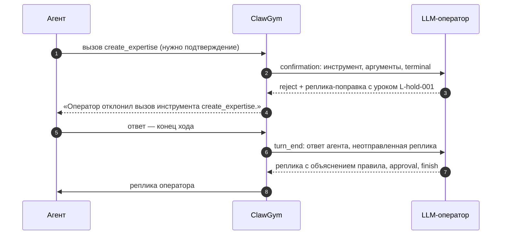
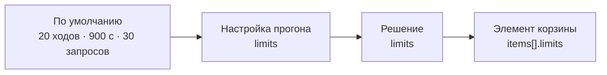

# Решения

[← Руководство](README.md) · [Кейсы](cases.md) · **Решения** · [Корзины](baskets.md) · [Шпаргалка](cheatsheet.md)

Решение — сценарий LLM-оператора для одного кейса: цель эксперимента и инструкция, как помогать агенту. Заглушки и эталон решение берёт из кейса и не копирует. Корзина состоит из решений, поэтому без решения кейс в корзину не попадёт — его можно пройти только вручную.

**На странице:** [файл и идентификатор](#файл-и-идентификатор) · [формат](#формат) · [что делает оператор](#что-делает-llm-оператор) · [режим корзины](#режим-корзины-важнее-инструкции) · [стили из демо](#стили-из-демо) · [как писать инструкцию](#как-писать-инструкцию) · [лимиты](#лимиты) · [чек-лист](#чек-лист-решения)

## Файл и идентификатор

- **Где лежит:** по соглашению `solutions/<id кейса>/<имя>.yaml`, например `solutions/card-hold-amount/explain-now.yaml`. Подкаталоги читаются на любую глубину, файл или папка на `_` пропускаются.
- **Идентификатор по умолчанию — путь** без `solutions/` и расширения: `card-hold-amount/explain-now`. По нему корзина ссылается на решение.
- **Связь с кейсом — поле `case`**, а не имя папки. Папка с `id` кейса — только соглашение, но его стоит держать: так решения кейса лежат рядом.
- **Переименовали или перенесли файл — изменился идентификатор.** Корзины со старой ссылкой получат ошибку «Решение «…» не найдено в solutions/». Если решения часто переезжают, задайте `id` явно.
- Два решения с одним идентификатором — ошибка.

## Формат

```yaml
case: card-hold-amount               # обязательно: id кейса
title: «Объясняет сразу»             # название; по умолчанию — идентификатор
goal: перестанет ли агент выставлять экспертизу по блокировке суммы, если правило объяснили сразу.
operator:
  instruction: >                     # обязательно: главное для LLM-оператора
    Отклоняй действия, которые расходятся с эталоном, и сразу объясняй правило.
    Если ответ клиенту неполный, скажи, что добавить, и объясни почему.
  style: explain-now                 # необязательная метка стиля
  seesToolResults: true              # видит ли оператор ответы инструментов
  lessons: []                        # дополнительные уроки к каталогу кейса
limits: { maxTurns: 12 }             # лимиты этого решения
# id: card-hold-amount/explain-now   # по умолчанию — путь файла
```

| Поле | Обязательно | По умолчанию | Значение |
| --- | --- | --- | --- |
| `case` | да | — | Идентификатор кейса. Нет такого кейса — ошибка |
| `operator.instruction` | да | — | Как помогать агенту. Главное, что отличает одно решение кейса от другого |
| `title` | нет | идентификатор | Название в корзине, результатах и сравнении. В демо — в кавычках-ёлочках: «Только факты» |
| `goal` | нет | пусто | Что проверяет эксперимент. Видно на странице кейса; оператору не передаётся |
| `operator.style` | нет | нет | Короткая метка стиля, например `explain-now`. Утверждённого перечня нет |
| `operator.seesToolResults` | нет | `true` | `false` — оператор видит вызовы инструментов, но не их ответы |
| `operator.lessons` | нет | `[]` | Уроки `{ id, rule }` в дополнение к каталогу кейса. Урок с тем же `id` заменяет урок кейса в этом решении |
| `limits` | нет | лимиты прогона | `maxTurns`, `maxDurationSec`, `maxOperatorCalls` — [Лимиты](#лимиты) |
| `id` | нет | путь файла | Явный идентификатор |

## Что делает LLM-оператор

LLM-оператор играет сотрудника второй линии, который ведёт обращение вместе с агентом. Его вызывают на двух событиях:

- **`confirmation`** — агент вызвал инструмент с подтверждением и ждёт. Оператор разрешает или отклоняет вызов и может приложить реплику. Сама она агенту не уходит: до конца хода агент мог сделать нужное сам.
- **`turn_end`** — агент закончил ход. Оператор решает, что ответить, одобряет ли результат и закончен ли кейс. Свои реплики к подтверждениям этого хода он видит как неотправленные (`unsentReplies`) и пишет агенту только то, что ещё нужно.



**Что оператор знает.** При каждом вызове — заново, без памяти между вызовами:

- режим корзины: `training` или `checking`;
- кейс: `id`, `title`, `topic`, `situation`, `start`, `facts`;
- эталон: процедуру, ответ, критерии, обязательные и запрещённые действия без `args`, итоговое действие;
- инструкцию и стиль решения, каталог уроков — кейса и решения;
- лимиты и сколько уже израсходовано;
- журнал диалога: реплики, вызовы инструментов с решениями и, если `seesToolResults` не `false`, их ответы.

**Что оператор возвращает:** реплику, решение по подтверждению, признак поправки и урок (`correction`, `lessonId`, `lessonNote`), признак объяснения правила, одобрение, завершение кейса и короткую причину решения для разбора. Агент видит только реплику и результат подтверждения.

Общие правила уже заданы системной подсказкой оператора `operator-v3`: не выдумывать факты, не пересказывать агенту эталон и не сообщать оценку, разрешать терминальное действие, только если финал верен, размечать поправки уроками, а в конце хода сверять неотправленные реплики с тем, что агент уже сделал. Инструкции решения повторять их не нужно — она задаёт стратегию помощи.

## Режим корзины важнее инструкции

Одно и то же решение ведёт себя по-разному в корзинах разных типов.

| | Обучающая корзина | Проверяющая корзина |
| --- | --- | --- |
| Инструкция решения | Исполняется | Обучающие указания не исполняются: режим проверки важнее инструкции |
| Поправки | Размечаются уроками, считаются в метриках | Запрещены. Если оператор пометил реплику как поправку, его переспрашивают один раз; при повторе кейс получает «Нарушение режима проверки» — технический сбой |
| Подтверждения | Решает оператор по инструкции | `checking.confirmations: approve` — разрешаются автоматически, оператор не вызывается; `operator` — решает оператор, без поправок |
| Вопросы агента | По инструкции | Только факты кейса. Факта нет — «таких данных нет» |

Поэтому для проверки заводят отдельное решение «Только факты» с прямой инструкцией. Режим защитит проверку и без неё, но обучающая инструкция в проверке провоцирует нарушения режима — лишние технические сбои.

## Стили из демо

Утверждённого перечня стилей нет. В демо их четыре — хорошая отправная точка:

| `style` | Название | Цель | Инструкция | Корзина |
| --- | --- | --- | --- | --- |
| `explain-now` | «Объясняет сразу» | Усвоит ли агент правило, если его сразу объяснили | Отклоняй действия, которые расходятся с эталоном, и сразу объясняй правило. Если ответ клиенту неполный, скажи, что добавить, и объясни почему. | обучающая |
| `explain-on-ask` | «Объясняет по вопросу» | Научится ли агент сам спрашивать о причине отказа | Отклоняй без объяснения и коротко указывай, что не так. Объясняй правило, только если агент спросит. | обучающая |
| `minimal` | «Помогает минимально» | Как агент справляется без объяснений | Помогай минимально: указывай на ошибку один раз, правило не объясняй даже по вопросу. | обучающая |
| `facts-only` | «Только факты» | Проверка текущих скиллов без обучения | Отвечай только на вопросы о фактах кейса. Не исправляй агента и не объясняй процедуру. Если факта нет в данных, скажи, что таких данных нет. | проверяющая |

Метка `style` видна оператору вместе с инструкцией, в интерфейсе и в записи прогона. Тестовая модель `dev/fake-gigachat` выбирает по ней своё поведение, поэтому в офлайн-демо метки из таблицы работают предсказуемее своих.

## Как писать инструкцию

- **Как помогать, а не что правильно.** Правильное решение оператор и так видит в эталоне. Инструкция отвечает на вопросы: когда отклонять, объяснять ли правило, сколько раз поправлять, что делать с вопросами агента.
- **Одна стратегия — одно решение.** Стратегия — переменная эксперимента, `goal` её называет. Чтобы сравнить стратегии, заведите несколько решений одного кейса.
- **Коротко и в повелительном наклонении.** В демо — одно-три предложения.
- **Без противоречий режиму и подсказке оператора.** «Подскажи агенту правильный ответ дословно» ломает обучение: агент учится на поправках, а не на готовых ответах.
- **Уроки — из каталога кейса.** Добавляйте `operator.lessons`, только если правило нужно именно этому сценарию. Неизвестный урок оператор не выдумает: он уйдёт в заметку и не попадёт в счёт известных уроков.

| Как не надо | Почему | Как надо |
| --- | --- | --- |
| «Помогай агенту» | Оператор не знает, насколько помогать | «Отклоняй без объяснения и коротко указывай, что не так» |
| «Правильный ответ — бонусы ожидают подтверждения партнёром» | Дублирует эталон; при правке кейса устареет | Ответ — в `reference.answer`, в инструкции — стратегия |
| «Сразу объясняй правило» в решении для проверки | В проверке не исполняется и провоцирует нарушение режима | Отдельное решение `facts-only` |
| Две стратегии в одной инструкции: «Сначала объясняй сразу, потом только по вопросу» | Результат нельзя приписать стратегии | Два решения |

**`seesToolResults: false`** — оператор видит вызовы, аргументы, решения и исходы, но не ответы инструментов. Это сценарий сотрудника, который не открывал системы и судит только по словам агента: например, чтобы проверить, верно ли агент пересказывает данные.

## Лимиты

Лимиты кейса складываются из четырёх уровней — побеждает более частный:



| Лимит | Диапазон | По умолчанию | Что ограничивает |
| --- | --- | --- | --- |
| `maxTurns` | 1–500 | 20 | Ответы агента в кейсе, включая ответ на стартовое сообщение |
| `maxDurationSec` | 10–86400 | 900 | Длительность кейса. Проверяется между ходами; сам ход ограничен `TURN_TIMEOUT_MS` |
| `maxOperatorCalls` | 1–1000 | 30 | Вызовы LLM-оператора: решения по концу хода и по подтверждениям. Автоматические подтверждения проверки не считаются |

Лимит задаётся по отдельности: `limits: { maxTurns: 12 }` меняет только ходы, остальное берётся с уровня выше. Исчерпанный лимит — не технический сбой: кейс получает «Исчерпан лимит …», оценивается, в обучении получает `/case-capture`.

> [!TIP]
> Лимит в решении — когда он нужен самой стратегии. Сценарию «Объясняет по вопросу» нужно больше ходов: агент должен догадаться спросить. Лимит под конкретную позицию корзины задают в элементе корзины.

## Чек-лист решения

- [ ] Файл в `solutions/<id кейса>/`, `case` указывает на существующий кейс
- [ ] `title` и `goal` объясняют, что проверяет эксперимент
- [ ] Инструкция описывает стратегию помощи, а не правильный ответ
- [ ] Для проверяющей корзины — отдельное решение «Только факты»
- [ ] `style` — короткая метка, одинаковая у решений одной стратегии в разных кейсах
- [ ] Лимиты заданы, только если они нужны стратегии
- [ ] Корзины ссылаются на актуальный идентификатор после переноса файла
