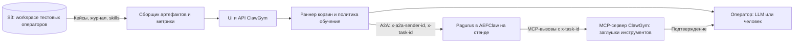

# План: ClawGym — тестовый оркестратор для проверки обучения агента

> Копия от 27 октября 2026 года для репозитория ClawGym. Оригинал — `plan.md` в проекте AEFClaw, sha256 `4cf3dee08e45`. Источник истины — оригинал: копия сама не обновляется.

Дата: 15 октября 2026 года. Заменяет вариант плана от 11 октября (эмулятор SmartCare).
Уточнение от 21 октября 2026 года: имя агента — **Pagurus**; AEFClaw — платформа его исполнения.
Заказчик: владелец проекта AEFClaw.
Исполнитель: агент разработки с доступом к коду Java-оркестратора.
Название: **ClawGym** (имя пакета, репозитория и образа — `clawgym`). Репозиторий задаёт владелец.
Первая версия — `plan_start.md`: чат с агентом на заглушках. Этот план — полное развитие после неё.

Дата обновления: 27 октября 2026 года.

### Актуальные решения владельца от 25 октября 2026 года

Источник: совместное обсуждение в этом чате. Подробные требования, задачи, зависимости и критерии приёмки — [gap.md](gap.md). Эта редакция уточняет план от 15 октября; сохранённые исторические примеры явно помечены.

- Кейс содержит ситуацию, заглушки и общий эталон. Несколько решений одного кейса различаются сценариями и инструкциями LLM-оператору.
- Корзины бывают обучающими и проверяющими; внутри одной корзины эти типы не смешиваются. Перед каждым кейсом обязателен `/reset`.
- В обучении capture вызывается после каждого завершённого кейса, включая неверно решённый; включение и частота curator настраиваются. В проверке capture и curator выключены, оператор только уточняет факты без обучающих подсказок.
- В прогоне выбираются корзина, агент, раздельные модели агента и оператора, версия прикладных скиллов и встроенные метрики. Подключение агента задаёт REST-контракт запроса и разбора ответа. *Пересмотрено решением владельца от 27 октября 2026 года: модель и скиллы — внутри агента; выбор версии набора, установка и выгрузка скиллов и выбор модели агента отложены. Прогон идёт на новом тестовом операторе или продолжает оператора прошлого прогона ([gap.md](gap.md), раздел 18).*
- Справочник наборов хранит прикладные скиллы. Комплект обучения и общие правила относятся к версии агента. Прогон получает рабочую копию выбранной версии, обучение создаёт новую версию со ссылками на исходную и прогон. *Пересмотрено решением владельца от 27 октября 2026 года: модель и скиллы — внутри агента; выбор версии набора, установка и выгрузка скиллов и выбор модели агента отложены. Прогон идёт на новом тестовом операторе или продолжает оператора прошлого прогона ([gap.md](gap.md), раздел 18).*
- Нужны автоматические проверки действий и отдельная LLM-оценка ответа после завершения, скрытая от агента. LLM-оператор и эта оценка входят в первую автоматическую версию.
- Настройки сначала в файлах; редакторы и глубокая диагностика повторов по внутреннему журналу — следующие этапы. Первые результаты включают чат, тулы, оценки, метрики и изменения скиллов. Пользовательские расчёты метрик отложены.
- Любой кейс можно запустить вручную с его заглушками без автоматического решения.
- Решения владельца от 25 октября 2026 года: стек — Node.js, чтобы приложение было легко собрать в Docker-контейнер; Dockerfile владелец делает сам.
- Решение владельца от 26 октября 2026 года: модели LLM-оператора и оценки поддерживают GigaChat API v1 и v2 по документации developers.sber.ru. Адрес настраивается, авторизация — клиентский сертификат. Сертификат необязателен: при установке внутри Istio достаточно http-адреса (уточнение владельца в тот же день).
- Решения владельца от 27 октября 2026 года:
  - проект направлен под 38 инструментов из `tools/list` стенда оркестратора;
  - формат запроса к AEFClaw — `aefclaw-a2a-message.json`;
  - подключения, модели и шаблоны — только реальный AEFClaw и fake для демо;
  - модели Anthropic и OpenAI убраны;
  - модель агента, стартовые и выученные скиллы — внутри агента и меняются только сборкой или обучением. Выбор версии прикладного набора, установка и выгрузка скиллов, версии наборов и выбор модели агента отложены. Прогон идёт на новом тестовом операторе или продолжает оператора прошлого прогона; «до и после обучения» — одна проверка на новом и на обученном операторе ([gap.md](gap.md), раздел 18).

Статус на 26 октября 2026 года: первая автоматическая версия реализована в репозитории `clawgym/` и проверена только офлайн, на заглушках агента и модели. Этап 0 (контракты с кода оркестратора) не выполнен, на стенде приложение не запускалось. Статус по задачам — [gap.md](gap.md), раздел 18; условные форматы и вопросы владельцу — `clawgym/docs/CONTRACTS.md`.

Поддержка установки выбранного прикладного набора ещё не подтверждена: это новое требование относительно ограничения стенда от 15 октября «стартовые скиллы меняются пересборкой». В `gap.md` отдельно перечислены технические вопросы установки, выгрузки, изоляции и выбора модели; требования не означают готовую реализацию. 27 октября 2026 года владелец решил пока отказаться от установки и выгрузки: скиллы живут у тестового оператора в агенте.

## 0. Как работать с этим планом

- Прочитать план целиком, затем выполнить **этап 0 (контракты)**. Всё, что приложение отправляет агенту и отдаёт ему как MCP-сервер, берётся **из кода оркестратора** со ссылкой `путь/Файл.java:строка`. Ничего не придумывать: агент учится в той обвязке, которую ему дали, и любое расхождение с ПРОМом делает результаты стенда непереносимыми.
- Если по коду нельзя однозначно установить формат или поведение, записать вопрос в раздел «Вопросы владельцу» файла `docs/CONTRACTS.md` и не угадывать. Независимые части делать дальше.
- Этапы выполнять по порядку, у каждого есть критерии приёмки. В конце этапа — короткий отчёт: что сделано, что проверено и как, что не получилось.
- Примеры имён инструментов, полей и текстов в этом плане **условные**. Реальные берутся из `docs/CONTRACTS.md` и `contracts/`.

### Материалы

| Материал | Зачем |
| --- | --- |
| Код Java-оркестратора | Контракты с агентом: A2A, стартовое сообщение, MCP-инструменты, подтверждения, служебные команды |
| Комплект обучения агента (`learning-scripts`): `README.md`, `INTEGRATION.md`, `AGENTS.md`, `learning_stats.py` — запросить у владельца | Форматы ответов capture и curator, раскладка workspace, журнал агента, определения метрик |
| Этот план | Требования и порядок работ |

## 1. Контекст

### Как агент работает на ПРОМе

Вторая линия поддержки банка. Оператор берёт обращение клиента в SmartCare и открывает чат с агентом. Чат передаёт сообщения в **Java-оркестратор**. Оркестратор:

- вызывает агента **Pagurus**, работающего в AEFClaw (форке OpenClaw в песочнице AEF Workstation), по REST/A2A;
- является **MCP-сервером** для агента. Информационные инструменты: обращение, клиент, дополнительные сведения. Активные: закрыть, отложить обращение, завести экспертизу (запрос в другое подразделение). Оркестратор выполняет их запросами к SmartCare и ещё одной системе;
- перехватывает вызовы инструментов и отправляет оператору на подтверждение. Агент в это время ждёт ответа на вызов инструмента, соединение висит. Подтверждение — оркестратор выполняет вызов и возвращает результат; отклонение — возвращает ошибку;
- отправляет агенту служебные команды в тот же диалог: `/reset` перед новым обращением, `/case-capture` после закрытия или отложения, периодически `/skill-curator`.

У каждого оператора своя сессия агента со своим workspace и обучаемыми skills. У оператора **один диалог**: параллельно от имени одного оператора ничего отправлять нельзя.

### Как агент учится

- В начале обращения агент вызывает каталог: learned skills тематики, общие skills и **свежие уроки** — явные поправки оператора из кейсов, ещё не обработанных curator.
- Оператор поправляет агента в чате. Если поправка без объяснения, агент задаёт короткий вопрос о правиле и условии, не больше двух за обращение.
- `/case-capture` сохраняет обращение как кейс с поправками и признаком силы знания.
- `/skill-curator` превращает накопленные кейсы в правки и новые skills.
- Журнал агента (`learning/journal/*.jsonl`) фиксирует, какой каталог агент получил, какие уроки ему показаны и какие skills он прочитал.

### Известные проблемы, ради которых нужен стенд

- После поправки в одном обращении агент повторяет ошибку в следующем похожем, в том числе после curator.
- Агент вызывает неуместные MCP-инструменты.
- Правка skill может исправить один случай и сломать другой.
- Нет измерения: учится ли агент, насколько быстро и от чего это зависит.
- Неизвестно, какая политика запуска capture и curator лучше. Найденную на стенде политику потом переносят в оркестратор.

## 2. Что делаем

Node.js-приложение, которое на тестовом стенде **заменяет оркестратор для агента**. Оно само вызывает Pagurus в AEFClaw по A2A, само является его MCP-сервером, имитирует оператора и прогоняет **корзины обращений**, измеряя обучение. SmartCare и системы за оркестратором не участвуют.



Роли приложения:

1. **A2A-клиент агента**: стартовое сообщение, реплики оператора, служебные команды — в точности как оркестратор.
2. **MCP-сервер**: те же инструменты с теми же описаниями и схемами, что у оркестратора; ответы — из сценария обращения; удержание вызова до решения по подтверждению.
3. **LLM-оператор** по инструкции и эталону; ручной режим через UI. Отдельная LLM оценивает ответ после завершения кейса.
4. **Раннер корзин** с настраиваемой политикой обучения: когда capture, когда curator.
5. **Сборщик артефактов** из S3 и **метрики обучения**.
6. **UI**: ручной чат, запуск корзин, кривые обучения, разбор каждого обращения.

### Чего не делаем

- Не эмулируем SmartCare и не проверяем интеграцию с ним и со второй системой — это задача обычных интеграционных тестов.
- Не используем реальные данные клиентов: только синтетика. К ПРОМу приложение не подключается.
- В первой автоматической версии настройки задаются файлами. Редакторы и глубокая диагностика повторов добавляются следующими этапами.

## 3. Что уже известно (владелец, 15 октября)

| Вопрос | Ответ |
| --- | --- |
| Можно ли направить MCP агента на стенде на `ClawGym` | Да |
| Как MCP-вызов связывается с сессией | Заголовок `x-task-id` приходит при каждом запросе к агенту; агент передаёт его при вызове любого MCP-инструмента |
| Где перехватываются подтверждения | В MCP-сервере. Агент ждёт ответа на вызов (соединение висит), пока сервер не вернёт результат или ошибку при отклонении |
| Доступ к S3 | Можно организовать |
| Новый тестовый оператор | Новый `x-a2a-sender-id` создаёт на агенте новую сессию со стартовым набором skills |
| Стартовый набор skills | Задаётся при сборке агента, новые сессии его получают. На ходу не меняется |
| Выгрузка workspace в S3 | При любом изменении |
| Таймаут MCP-вызова | Настраивается на стороне агента |
| Доступ к модели для самого приложения | Можно организовать (LLM-оператор, модель-судья) |
| Путь к workspace в S3 | Вычисляется специальным алгоритмом; скрипт владелец передаст к этапу 4 |
| Сборки агента на стенде | Одна. Другой стартовый набор — только пересборкой |
| Одновременные сессии на стенде | 2–3 |
| Эталонная политика обучения | Как в `INTEGRATION.md`. Цель — найти на стенде лучшую и затем доработать оркестратор |

## 4. Этап 0. Контракты из кода оркестратора

Результат:

- `docs/CONTRACTS.md` — описание с примерами JSON и ссылками на код;
- `contracts/tools.json` — определения MCP-инструментов **дословно**: имя, описание, входная схема, признак подтверждения, тип (информационный или активный);
- `contracts/start-message.*` — шаблон стартового сообщения;
- скрипт сверки с настоящим оркестратором (п. 4.9).

Что найти:

1. **Вызов агента по A2A.** Эндпоинт, метод, тело сообщения, заголовки: как формируется `x-a2a-sender-id` из сведений об операторе; когда генерируется `x-task-id` — на каждое сообщение или на обращение; авторизация. Как приходит ответ: синхронно в теле, потоком или через опрос задачи. Бывают ли промежуточные сообщения. Таймауты, повторы, ошибки.
2. **Стартовое сообщение.** Какие данные оркестратор собирает и в каком виде отправляет агенту. Есть ли строки `Тематика:` и `request_ref:`, как вычисляется `request_ref`.

   Известно 26 октября 2026 года по фото кода `TaskService.processTask`, которое прислал владелец. Сообщение состоит из:
   - промпта из `openClawConfig`;
   - блока в ``` со строками `Тематика:` и `request_ref:`, где `request_ref` = `taskId`;
   - JSON-результатов четырёх вызовов `armCzkService`: кейс, статические атрибуты, клиент, динамические атрибуты.

   Остаётся снять текст промпта и реальные ответы. ClawGym повторяет такой формат шаблоном (`clawgym/docs/FORMATS.md`).

   Запрос к агенту и его ответ сняты 26–27 октября 2026 года по фото подключения и шаблона: `SendMessage` с `contextId` = x-task-id, ответ в `result.task.status.message.parts`. Список MCP-инструментов — по фото `tools/list` стенда: 38 инструментов в `clawgym/contracts/tools.json`, точный список снимается командой `import-tools`.
3. **Реплика оператора.** Передаётся ли текст как есть или с префиксами и метаданными. Всё, что оркестратор добавляет к сообщениям.
4. **MCP-сервер.** Транспорт и версия протокола (должны совпадать с тем, что ожидает MCP-клиент AEFClaw), эндпоинт, сессии MCP, как читается `x-task-id`. Полный список инструментов дословно. Формат успешного результата и ошибок; отдельно — точный текст ошибки при отклонении, потому что агент учится и на нём. Инструмент можно выключить флагом `enabled: false`, не удаляя его описание: его не будет в `tools/list` (решение владельца от 26 октября 2026 года).
5. **Подтверждения.** Какие инструменты требуют подтверждения. Что показывается оператору (инструмент, аргументы). Сколько оркестратор держит вызов. Таймаут MCP-вызова настраивается на стороне AEFClaw: записать значение на стенде и как его менять. От него зависит, сколько может думать человек в ручном режиме.
6. **Служебные команды.** Когда отправляются `/reset`, `/case-capture`, `/skill-curator`, точный текст с аргументами. Как оркестратор ждёт и разбирает ответы, таймауты, обработка сбоев. Эталон для стенда — `INTEGRATION.md` (решение владельца). Оркестратор на ПРОМе может вести себя иначе: различия записать, политика `prod` нужна только для сравнения (п. 6.5).
7. **Конфигурация агента на стенде.** Что поменять в AEFClaw, чтобы MCP указывал на `ClawGym`; нужен ли TLS; есть ли ограничения на число одновременных сессий.
8. **Прочее поведение оркестратора**, которое влияет на агента: скрытие служебных команд, ограничения на длину, обработка вложений, повторные попытки.
9. **Сверка.** Скрипт, который на тестовом контуре запрашивает у настоящего оркестратора список MCP-инструментов (и, если возможно, шаблон стартового сообщения) и сравнивает с `contracts/`. Расхождение — ошибка с понятным отчётом. Запускать перед прогоном корзин и в CI.

**Приёмка.** Каждый пункт закрыт ссылкой на код или вопросом владельцу. Для всех форматов есть примеры JSON. `tools.json` совпадает с ответом настоящего оркестратора. Владелец ответил на вопросы, без которых нельзя начать этап 1.

## 5. Архитектура

### Стек

- Node.js LTS из доступных в контуре (не ниже 20), TypeScript.
- HTTP: Fastify или аналог.
- MCP-сервер: официальный TypeScript SDK MCP, если его транспорт и версия совпадают с ожидаемыми AEFClaw; иначе — реализация протокола по п. 4.4.
- Обращения и корзины: YAML (`yaml`), валидация JSON Schema (`ajv`).
- S3: совместимый клиент, доступ только к префиксу тестовых операторов стенда.
- LLM: за своим интерфейсом, провайдер — по доступу, который организует владелец. По решению владельца от 26 октября 2026 года поддержан GigaChat API v1 и v2 с авторизацией сертификатом; с 27 октября GigaChat — единственный провайдер.
- UI: статический фронт отдаётся тем же процессом, обновления через SSE, графики — библиотека из бандла. **Без внешних CDN и шрифтов**: стенд в закрытом контуре.
- Хранение: кейсы, решения, корзины, справочники и настройки запусков — файлы; результаты прогонов — отдельные JSON-журналы и сводки. Версии прикладных наборов сохраняются с составом файлов и происхождением. БД — только если файлов станет мало для отчётов.
- Минимум зависимостей; проверить их наличие во внутреннем npm-репозитории.
- Поставка: Docker-образ, healthcheck `GET /health`. Dockerfile готовит владелец (решение 25 октября 2026 года); что нужно образу — в `clawgym/README.md`.

### Структура (предложение)

```
clawgym/
  docs/CONTRACTS.md
  contracts/                tools.json, start-message.*, tool-defaults.yaml
  cases/                    кейсы с заглушками и общим эталоном
  solutions/                сценарии LLM-оператора, ссылки на кейсы
  agents/  models/          подключения и модели
  skillsets/                версии прикладных наборов
  metrics/  runs/           определения метрик и настройки запусков
  baskets/                  корзины *.yaml
  policies/                 политики обучения *.yaml
  data/                     JSON-ответы инструментов, общие для обращений
  src/
    a2a/                    клиент агента
    mcp/                    MCP-сервер, заглушки инструментов, удержание вызовов
    sessions/               тестовые операторы (sender-id), привязка task-id → прогон
    cases/  baskets/        загрузка и валидация
    operator/               LLM-оператор и ручной режим
    judge/                  отдельная оценка ответа
    skillsets/              подготовка рабочих копий, выгрузка версий
    policy/                 политика обучения: reset, capture, curator
    runner/                 выполнение обращений и корзин, параллелизм
    artifacts/              сбор из S3, разбор журнала и кейсов агента
    metrics/
    api/  web/
  scripts/drift-check.ts
  dev/fake-agent/           заглушка агента по CONTRACTS.md: A2A-сервер и MCP-клиент
  test/
```

### Конфигурация (переменные окружения)

| Переменная | Назначение |
| --- | --- |
| `AGENT_URL` | A2A-эндпоинт Pagurus в AEFClaw на стенде |
| `AGENT_BUILD` | Метка сборки агента, если agent card A2A её не отдаёт (п. 6.3) |
| `AGENT_MCP_TIMEOUT_MS` | Таймаут MCP-вызова, настроенный в агенте на стенде. По нему считаются обратный отсчёт в ручном режиме и запас для автоматических решений. Рекомендуемая настройка агента на стенде — не меньше 10 минут |
| `AGENT_ALLOWED_HOSTS` | Белый список хостов агента; при старте приложение отказывается работать с адресом вне списка, чтобы его нельзя было направить на ПРОМ |
| `MCP_PORT` / путь MCP | Куда AEFClaw отправляет MCP-вызовы |
| `SENDER_PREFIX` | Префикс `x-a2a-sender-id` тестовых операторов, например `lab-` |
| `MAX_PARALLEL_SESSIONS` | Сколько тестовых операторов работают одновременно: по умолчанию 2, на стенде не больше 3 |
| `TURN_TIMEOUT_MS` | Таймаут ответа агента на одно сообщение |
| `CAPTURE_TIMEOUT_MS`, `CURATOR_TIMEOUT_MS` | Таймауты служебных команд |
| `S3_*` | Доступ к workspace тестовых операторов |
| `LLM_*` | Доступ к модели для LLM-оператора и судьи |
| `CASES_DIR`, `BASKETS_DIR`, `DATA_DIR`, `RUNS_DIR` | Каталоги |

## 6. Модель и поведение

### 6.1. Кейс и решение кейса

Кейс — YAML-файл с исходной ситуацией, стартовыми данными, заглушками и общим эталоном. Решение — отдельный файл со ссылкой на кейс и инструкцией LLM-оператору. Несколько решений используют одинаковые данные и правильное решение, меняя способ помощи. Конкретная схема файлов должна быть согласована на задаче CFG-01 из `gap.md`.

| Данные кейса | Смысл |
| --- | --- |
| Идентификатор, название, теги | Поиск и ссылки на подготовленную ситуацию |
| Тематика | Точное название тематики; используется в сообщениях, каталоге и метриках |
| Стартовые данные | Поля по шаблону оркестратора. Ссылка на конкретное обращение стабильна для его диалога и capture; отличается от идентификатора шаблона кейса |
| Заглушки | Ответы инструментов по п. 6.2 |
| Общий эталон | Обязательные и запрещённые действия, ожидаемая процедура и правильный ответ |

Поведение оператора не хранится в кейсе. Ручной запуск не требует файла решения.

### 6.2. Заглушки инструментов

- Ответ задаётся на имя инструмента. `when` — совпадение подмножества аргументов (равенство или регулярное выражение), чтобы на разные аргументы давать разные ответы.
- Ответ: `result` (одно из `json` / `file` / `text`) или `error`; необязательный `delayMs`. Обёртка результата и ошибки — в формате оркестратора из п. 4.4: агент должен видеть ровно то, что увидел бы на ПРОМе.
- `sequence` — ответы на последовательные вызовы, последний повторяется.
- `effect` — изменение состояния прогона (например, статус обращения после закрытия), доступное в шаблонах `{{state.*}}`.
- Шаблоны: `{{case.*}}`, `{{start.*}}`, `{{args.*}}`, `{{state.*}}`, `{{now}}`.
- Поиск ответа: обращение → `contracts/tool-defaults.yaml`. Если ответа нет, агент получает ошибку в формате оркестратора, а вызов пишется в журнал как **непредусмотренный**. Такие вызовы — прямой сигнал «вызывает что попало».
- Каждый MCP-вызов пишется в журнал: инструмент, аргументы, `x-task-id`, найденный ответ, решение по подтверждению, длительность.

### 6.3. Сессии и привязка вызовов

- **Тестовый оператор** — это `x-a2a-sender-id`. Новый идентификатор даёт новую сессию со стартовым набором skills. Идентификаторы строятся как `SENDER_PREFIX` + корзина + повторение + уникальный хвост и сохраняются в прогоне: по ним путь к workspace в S3 вычисляется скриптом владельца (п. 6.7).
- Каждый запрос к агенту получает `x-task-id` по правилу оркестратора из п. 4.1. Приложение хранит соответствие `x-task-id` → прогон и обращение. MCP-вызов с неизвестным или отсутствующим `x-task-id` получает ошибку и пишется в общий журнал стенда.
- На одного тестового оператора в каждый момент — не больше одного активного обращения: у оператора один диалог. Параллельность — только между разными операторами, не выше `MAX_PARALLEL_SESSIONS`.
- **Сборка и знания.** По сведениям от 15 октября, на стенде одна сборка и смена стартового набора требовала пересборки. Целевое требование от 25 октября: прикладной набор выбирается из справочника и подготавливается в рабочей копии до прогона; комплект обучения и общие правила остаются частью версии агента. Механизм установки ещё нужно реализовать и проверить. Прогон фиксирует версию сборки (`agent card` либо `AGENT_BUILD`), моделей и прикладных скиллов. Техническая сессия не заменяет выбора набора. При недоступном агенте очередь приостанавливается, а не выдаёт обращения за неверно решённые.

### 6.4. LLM-оператор и отдельная оценка

LLM-оператор получает общий эталон кейса, инструкцию выбранного решения, режим корзины и события текущего диалога. Он возвращает структурированное решение: реплику, решение по подтверждению, разметку обучающей поправки и урока, признак завершения. Ответы проверяются по схеме; ограничения ходов и времени предотвращают бесконечный диалог. Ошибка оператора учитывается отдельно от ошибки тестируемого агента.

- В обучающей корзине помощь и объяснения определяются сценарием решения.
- В проверяющей разрешены уточнения фактов; исправления и подсказки процедуры запрещены. Режим проверки имеет приоритет над обучающей инструкцией сценария.
- События: конец хода агента, вопрос, MCP-вызов с подтверждением. В один диалог сообщения и команды отправляются последовательно; по удерживаемому инструменту решение нужно вернуть до его таймаута.
- Отдельная LLM после завершения оценивает сохранённый ответ по общему эталону. Она не играет оператора, не отправляет оценку агенту и не запускает обучение. Автоматические проверки сопоставляют действия с эталоном.
- Ручной режим показывает те же события человеку; автоматический оператор в нём не действует.

Детальная декомпозиция — SOL-01–06 и MET-05 в `gap.md`.

<details>
<summary>Исторический вариант от 15 октября: правила до внедрения LLM</summary>

Этот вариант сохранён для контекста. Он не требует реализации детерминированного оператора до LLM и не задаёт актуальный объём первой версии.

Поведение агента в обучающей корзине по замыслу меняется от обращения к обращению, поэтому линейный скрипт не годится. Имитатор реагирует на **события**:

| Событие | Когда |
| --- | --- |
| `tool_call` | Агент вызвал инструмент. Для инструментов с подтверждением имитатор обязан принять решение, пока вызов удерживается |
| `agent_turn` | Агент закончил ход и ждёт оператора |
| `agent_question` | Ход агента содержит вопрос оператору: о причине поправки или уточнение. Распознавание — по правилу (регулярное выражение), позже LLM-классификатор |

Правила (детерминированный режим):

```yaml
operator:
  style: on-question        # explains | on-question | never
  rules:
    - id: check-operations-before-close     # id урока, общий для разных обращений
      when: { tool: close_case, notCalledBefore: get_client_operations }
      confirm: reject
      say: Сначала проверь историю операций по карте
      explain: >
        Без истории операций не видно, заблокирована карта из-за PIN
        или по подозрению в мошенничестве
  accept:
    when: { calledAll: [get_client_operations], agentTurn: { matches: "PIN" } }
    say: Всё верно, ответ хороший, можно закрывать
  confirmations: approve    # решение для подтверждений, не покрытых правилами
  maxOperatorTurns: 8
```

- `when` по инструментам: `tool`, `args`, `notCalledBefore`, `calledBefore`. По тексту хода: `agentTurn.matches` / `notMatches`.
- Сработавшее правило — **поправка**. Если правило отклоняет подтверждение, агент получает ошибку отклонения, а текст `say` уходит следующей репликой, когда агент закончит ход. Так ведёт себя оператор на ПРОМе: отклоняет, потом пишет в чат.
- `style` задаёт, как оператор объясняет поправки. `explains` — сразу добавляет `explain`. `on-question` — объясняет только в ответ на вопрос агента. `never` — не объясняет, как часто бывает на ПРОМе. Это параметр эксперимента: AGENTS.md учит агента спрашивать о причине поправки.
- `accept` — оператор одобряет результат; дальше агент должен выполнить итоговое действие.
- Обращение заканчивается, когда выполнено итоговое действие (активный инструмент успешно отработал), исчерпан `maxOperatorTurns`, истёк таймаут или в ходе нет ни одного подходящего правила и нет `accept`. Последнее — **отклонение от сценария**: прогон помечается, ход и последнее событие сохраняются для разбора.
- Правила решают по подтверждению сразу. LLM-оператор должен уложиться в `AGENT_MCP_TIMEOUT_MS` с запасом; если не успел, ClawGym сам отклоняет вызов и пишет это в журнал как сбой имитатора, а не как поправку.
- **Ручной режим**: те же события показываются в UI; человек пишет реплики и решает по подтверждениям, видя обратный отсчёт до `AGENT_MCP_TIMEOUT_MS`. В UI можно пометить свою реплику как поправку с id урока, чтобы ручные прогоны тоже давали метрики.
- **LLM-оператор** (этап 5) получает эталон обращения, правила как ориентир и стиль. Решения возвращает структурированно: реплика, решение по подтверждению, является ли реплика поправкой и какого урока. Без этой разметки метрики не посчитать.

</details>

### 6.5. Политика обучения

Политика определяет служебные команды. Команды отправляются тем же A2A-вызовом и тем же `x-a2a-sender-id`, что и обращения.

| Параметр | Значения |
| --- | --- |
| `reset` | Обязательно перед каждым обращением обоих типов корзин, как на ПРОМе (уточнение владельца, 25 октября) |
| `capture` | После каждого завершённого обучающего кейса, включая неверный результат; выключен в проверяющей корзине |
| `curator` | Только в обучающей корзине: выключен или по настроенной частоте; дополнительные варианты — по согласованной схеме политики. В проверяющей выключен |

Эталон порядка и семантики обучающих команд — `INTEGRATION.md`; частота curator задаётся обучающей корзиной. Проверяющая корзина запрещает capture и curator независимо от профиля. Политика `prod` нужна только для сравнения, если на этапе 0 найдены отличия. Тексты команд и разбор ответов не выдумывать.

Подбор политики — одна из целей стенда: лучшую владелец перенесёт в оркестратор. Поэтому политики задаются декларативно в `policies/*.yaml`, без логики, размазанной по раннеру, и каждая описана так, чтобы её можно было один в один реализовать в Java. Итог серии экспериментов — отчёт сравнения политик с рекомендацией.

Ответы разбираются регулярными выражениями из `INTEGRATION.md`:

- capture: `Case captured: <путь> — signal: <сила>`, `Case capture skipped: …`, `Case capture failed: …`;
- curator: `Curator complete: N processed, … Report: <путь>`, `No pending cases.`, `Curator failed: …`.

Результат каждой команды и её длительность пишутся в журнал прогона. Нераспознанный ответ или таймаут — сбой команды, видимый в отчёте.

### 6.6. Корзины, прогоны и версии скиллов

*Пересмотрено решением владельца от 27 октября 2026 года: модель и скиллы — внутри агента; выбор версии набора, установка и выгрузка скиллов и выбор модели агента отложены. Прогон идёт на новом тестовом операторе или продолжает оператора прошлого прогона ([gap.md](gap.md), раздел 18).* Сравнение: проверяющая корзина на новом операторе → обучающая корзина → та же проверяющая корзина на операторе обучения.

Корзина — набор решений кейсов одного типа: обучающего или проверяющего. Порядок и периодичность curator задаются файлами. Детальная модель — BASK-01–05 и SK-01–06 в `gap.md`.

- **Обучающая:** перед каждым кейсом reset, после каждого завершённого кейса capture, curator по настройке. Рабочая копия знаний развивается между кейсами; повторная установка исходного набора перед каждым кейсом запрещена. Итог — новая версия прикладных скиллов со ссылками на исходную и прогон.
- **Проверяющая:** выбранная версия прикладных скиллов, reset перед каждым кейсом, без обучения. Оператор только уточняет факты; capture и curator выключены. Оценка ответа выполняется отдельно после кейса.
- **Прогон:** выбранные корзина, REST-подключение агента, модель агента, модель оператора, версия скиллов и встроенные метрики. Модель судьи, точные лимиты и технические параметры определяются в конфигурации реализации и фиксируются в результате.
- **Изоляция:** каждый прогон и независимый повтор получают свою рабочую копию прикладных знаний без чужих pending-кейсов и свежих уроков. Новый sender-id сам по себе это не доказывает; установку и исходное состояние нужно проверить.
- **Сравнение:** одна проверяющая корзина на V1 → обучение копии V1 с получением V2 → та же проверяющая корзина на V2. Это отдельные корзины и прогоны, не смешанная корзина train/test.
- **Очередь:** учитывать ограничения сессий стенда; один диалог на оператора. Сохраняются очередь, время старта, остановка и повторения из исходного плана. В отчёте показывать число повторений и разброс; несколько повторений не выдавать за доказательство значимости эффекта.

<details>
<summary>Историческая схема от 15 октября: смешанная корзина train/test и выбор обученного оператора</summary>

Схема сохранена для контекста. Она заменена двумя типами корзин и явным выбором версии прикладных скиллов. Ограничение «без установки workspace» из этой схемы не удовлетворяет новому требованию.

Корзина — упорядоченные шаги на одной линии тестового оператора. Повторение корзины запускается на новом `x-a2a-sender-id`; повторения могут идти параллельно.

```yaml
id: cards-blocking-learning
title: Обучение на блокировках карт
sender: fresh               # fresh | existing:<sender-id>
repetitions: 3
operator: rules             # rules | llm
style: on-question          # переопределяет style обращений
policy: integration
steps:
  - phase: train
    capture: true
    cases: [card-blocked-wrong-pin, card-blocked-wrong-pin-2]
  - curator: true
  - phase: test
    capture: false
    cases: [card-blocked-wrong-pin-3, card-blocked-fraud]
```

- **Обучающая корзина**: фаза `train` с capture, затем при необходимости curator, затем фаза `test` без capture на похожих, но других обращениях. Фаза `test` без capture не меняет знания агента, поэтому её результат чисто показывает, чему он научился.
- **Оценочная корзина**: только `test`, без capture и curator. Запускается на стартовом наборе текущей сборки (`sender: fresh`) или на уже обученном операторе (`sender: existing:<id>`). Фаза без capture не меняет знаний оператора, поэтому одну оценочную корзину можно прогонять на обученном операторе многократно — но только последовательно: у оператора один диалог.
- **Проверка правки curator**: на обученном операторе `test` → `curator` → тот же `test`. Разница между двумя фазами `test` — вклад этого прохода curator. Снимки и засев workspace для этого не нужны.
- **Сравнение стартовых наборов skills или версий комплекта обучения** — только последовательно: корзина на текущей сборке, пересборка, та же корзина. ClawGym сравнивает прогоны по версии сборки. Всё, что ещё поменялось между сборками (модель, версия AEFClaw), должно быть отражено в метке сборки.

**Очередь и длительность.** На стенде 2–3 одновременные сессии, а один ход агента может занимать минуты. Поэтому:

- корзины ставятся в очередь и выполняются по мере освобождения сессий; можно задать время старта, например на ночь;
- UI показывает оценку длительности по прошлым прогонам и позволяет остановить корзину;
- при 3 повторениях разброс большой: отчёт показывает минимум и максимум по повторениям и не называет разницу значимой, если диапазоны перекрываются. Для решений, которые пойдут в оркестратор, нужно больше повторений — ночными прогонами.
- При `sender: fresh` и одном обращении на оператора обращения оценочной корзины можно гонять параллельно, каждое на своём новом операторе.

</details>

### 6.7. Артефакты обучения

Первая автоматическая версия сохраняет кейсы capture, отчёты curator, версии прикладных скиллов и их изменения. Разбор внутреннего журнала каталога и чтения скиллов для диагностики повторов — следующий этап (решение владельца, 25 октября). Описанный ниже S3-сборщик читает артефакты; механизм установки выбранного набора — отдельная задача, не подразумеваемая доступом на чтение.

После каждого обращения и после curator сборщик фиксирует:

- из ответов агента: путь сохранённого кейса и силу сигнала (capture), отчёт curator;
- из S3, по workspace тестового оператора. Путь к workspace вычисляется специальным алгоритмом; скрипт владелец передаст к этапу 4. Его логику держать в одном модуле (`artifacts/workspace-path`). Раскладка внутри workspace — `README.md` комплекта: сохранённые кейсы `learning/cases/*`, журнал `learning/journal/*.jsonl` (события `catalog.listed`, `skill.provided`, `skill.read`, уроки), каталог `skills/` — снимок и изменения после curator.

Workspace выгружается в S3 при каждом изменении. Небольшая задержка всё же возможна, поэтому сборщик не читает S3 вслепую сразу после события, а ждёт ожидаемого признака. После capture — файл кейса по пути из ответа агента. После curator — отчёт по пути из ответа. Ожидание ограничено таймаутом; если признак не появился, артефакты помечаются как неполные. Доступ к S3 — только чтение.

### 6.8. Метрики

В первой автоматической версии справочник задаёт встроенные расчёты и их параметры; набор выбирается на прогон. Новые пользовательские формулы и модули отложены. Действия проверяются автоматически, смысл ответа — отдельной LLM после завершения, скрыто от агента. Ошибки оператора, судьи и технические сбои учитываются отдельно; отсутствие данных не заменяется нулём. Предложенные определения и правила агрегации — MET-01–05 в `gap.md`.

По обращению:

- **поправки** — сработавшие правила (или помеченные LLM-оператором и человеком реплики);
- **повторные поправки** — урок с тем же id уже давался ранее на этой линии оператора;
- отклонённые подтверждения;
- непредусмотренные вызовы инструментов; вызовы вне эталона;
- успех — по проверкам действий и отдельной LLM-оценке ответа; мнение оператора хранится отдельно, точное правило объединения задаётся явно;
- ходы, длительность, токены (если A2A их отдаёт).

По корзине:

- **кривая обучения** — поправки по номеру обращения, среднее и разброс по повторениям;
- доля повторных поправок;
- успех и поправки в фазе `test`;
- сравнение двух прогонов: политики, стили оператора, версии skills, модели.

**Диагностика повторов — следующий этап.** Для каждой повторной поправки по журналу агента определить, что произошло:

1. урок или skill не был показан в каталоге;
2. показан, но skill не прочитан;
3. прочитан, но не применён.

Это прямой ответ на главный открытый вопрос проекта — почему ошибка повторяется после поправки и после curator.

Определения доли поправок и повторов согласовать с `learning_stats.py`, чтобы результаты стенда и ПРОМа были сравнимы.

**Метрики аналитика (27 октября 2026 года, предложение, которое владелец хочет применять).** Тестовый датасет до и после обучения.
- **M1** — macro-F1 класса финального действия.
- **M2** — среднее по кейсам от `w_tools · F1_tools + w_answer · A_judge`, где `A_judge` — среднее 3 прогонов судьи по эталонному финальному тексту.

Для этих метрик у кейса нужен эталон:
- класс финального действия;
- минимально достаточный набор инструментов;
- итоговый текст.

Эталон берётся из прод-логов операторов или разметки эксперта, не из навыка агента.

По просьбе владельца от 27 октября 2026 года метрики реализованы в ClawGym в тот же день и проверены офлайн. Подробнее — `gap.md`, раздел 18.

### 6.9. UI

В первой автоматической версии настройки читаются из файлов; UI запускает и показывает кейсы, решения, два типа корзин и результаты. При запуске выбираются модели агента и оператора, версия прикладных скиллов и метрики. Редакторы и глубокая диагностика — следующие этапы. Детализация экранов ниже применяется с этим разделением.

- **Обращения**: список с тематикой и тегами; запуск вручную на новом или существующем операторе.
- **Ручной прогон**: чат; живой журнал MCP-вызовов; подтверждения с кнопками и обратным отсчётом; отметка поправок; служебные команды и их ответы — отдельным оформлением. Реплика отправляется по Enter (уточнение владельца от 26 октября 2026 года).
- **Корзины**: запуск с выбором политики, режима оператора, стиля и числа повторений; очередь с оценкой длительности и временем старта; ход выполнения по повторениям и обращениям; остановка.
- **Результат корзины**: кривая обучения, таблица поправок по урокам, диагностика повторов, успех в фазе `test`. Переход в любое обращение: переписка, MCP-вызовы, сработавшие правила, служебные команды, артефакты (сохранённый кейс, показанные уроки, прочитанные skills, изменения skills после curator).
- **HTTP-обмены** (уточнение владельца от 26 октября 2026 года): из кейса и ручной сессии можно открыть все REST-взаимодействия «запрос — ответ». Это вызовы агента стендом и вызовы MCP агентом: заголовки без секретов, тела, статус, время. Есть переход к соответствующему событию журнала.
- **Удаление** (решение владельца от 26 октября 2026 года). Завершённый прогон удаляется кнопкой с подтверждением и методом API. Идущие прогоны не удаляются; версии скиллов, полученные прогоном, остаются.
- **Сравнение** двух прогонов корзины: разные политики, стили оператора, сборки агента. Отчёт сравнения политик с рекомендацией.
- **Сверка контрактов**: результат последнего `drift-check`.
- Язык интерфейса — русский.

## 7. Этапы

### Этап 0. Контракты

См. раздел 4.

### Этап 1. MCP-сервер, A2A-клиент, ручной режим

- Каркас, конфигурация, белый список хостов, `/health`, Docker-образ.
- MCP-сервер с инструментами из `contracts/tools.json`, заглушки по п. 6.2, удержание вызовов с подтверждением.
- A2A-клиент: стартовое сообщение, реплики, `x-a2a-sender-id`, `x-task-id`.
- Ручной режим в UI.
- `dev/fake-agent` строго по `CONTRACTS.md`: принимает A2A, вызывает инструменты с `x-task-id`, ждёт подтверждения. Интеграционные тесты `ClawGym` ↔ fake-agent. Unit-тесты: заглушки, шаблоны, привязка `x-task-id`, валидация обращений.
- `drift-check`.

**Приёмка на стенде.** Одно обращение вручную с настоящим агентом на новом тестовом операторе. MCP-вызовы приходят с `x-task-id` и привязываются к прогону. Подтверждение удерживает вызов до решения в UI. После отклонения агент получает ту же ошибку, что от оркестратора, и продолжает. Журнал прогона сохранён, версия сборки агента в нём записана. `drift-check` проходит.

### Этап 2. LLM-оператор, команды и оценка

- Разделение кейса и решений; общий эталон у кейса.
- LLM-оператор по п. 6.4, отдельные подключение и модель; структурированная разметка поправок и ошибок.
- Reset, capture и curator по п. 6.5; capture после каждого завершённого обучающего кейса.
- Автоматические проверки действий и отдельная LLM-оценка ответа после завершения. Модель-судья сверяется с человеческими оценками на согласованной выборке; калибровка и её ограничения отражаются в результатах.
- Запуск решения без UI через CLI или HTTP; полный журнал, понятные лимиты и статусы сбоев.

**Приёмка.** Решение кейса проходит без человека; видны реплики, тулы, поправки, исход команд, проверки действий и отдельная оценка ответа. Сбой оператора или судьи различим с неуспехом агента; оценка не отправляется агенту.

### Этап 3. Два типа корзин, наборы скиллов и встроенные метрики

*Пересмотрено решением владельца от 27 октября 2026 года: модель и скиллы — внутри агента; выбор версии набора, установка и выгрузка скиллов и выбор модели агента отложены. Прогон идёт на новом тестовом операторе или продолжает оператора прошлого прогона ([gap.md](gap.md), раздел 18).* Пункты о рабочей копии, выгрузке, версиях и неизменности ниже — исходные требования, сейчас отложены.

- Справочники агентов, моделей, версий прикладных скиллов и встроенных метрик; файловые настройки запусков.
- Подготовка и проверка рабочей копии выбранной версии до прогона. Комплект обучения и общие правила определяются версией агента. Этот механизм можно разрабатывать раньше параллельно другим задачам; без него этап не завершён.
- Обучающие и проверяющие корзины по п. 6.6, очередь, остановка, независимые повторения и ограничения параллельности.
- Базовые артефакты первой версии: capture, отчёты curator, исходное и итоговое состояние прикладных скиллов, различия после curator. Источник выгрузки подтверждается контрактом; при использовании S3 понадобится скрипт пути workspace владельца.
- Новая версия после обучения, неизменяемый исходный набор и снимок настроек каждого прогона.
- Выбор встроенных метрик, результаты и сравнение прогонов. Глубокий разбор журналов в этот этап не входит.

**Приёмка.** Рабочая копия V1 проходит обучающую корзину и даёт V2; V1 не меняется. Одна проверяющая корзина отдельно запускается на V1 и V2 с одинаковыми моделями и параметрами. Нет обучающих реплик, capture и curator при проверке; в результате доступны оценки, метрики, чат, тулы и изменения скиллов. Независимые повторения не делят знания и pending-кейсы. Реализованы сквозные сценарии первой версии из `gap.md`.

### Этап 4. Следующее развитие

- Редакторы настроек поверх тех же файловых схем: кейсы и заглушки, решения, корзины, справочники, конфигурации прогонов.
- Внутренний журнал агента, диагностика повторов и переходы к событиям-доказательствам. Если данных нет, причина остаётся неопределённой.
- Порядок между редакторами и глубокой диагностикой отдельно не выбран; это самостоятельные пакеты UI-01–05 и DIAG-01–03 в `gap.md`.

**Приёмка.** Редактор не вводит второй формат настроек. Диагностика различает наблюдаемые причины повторной ошибки и показывает исходные события; наличие скилла в каталоге не подменяет факт его чтения.

### Этап 5. Дальнейшие расширения

- Новые пользовательские формулы и вычислительные модули метрик.
- Импорт черновиков кейсов из capture на стенде или обезличенных данных. Поля: `Request`, `Important context`, `Correct resolution`, `Successful procedure`, `What was wrong before`, `Failed or unnecessary approaches`.
- Автоматическая связка обучения и проверки каждого прохода curator, оценка регрессий и срабатываний вне тематики. Отдельные проверяющие прогоны на версиях уже поддерживаются этапом 3; автоматический конвейер — отдельное расширение.

LLM-оператор и отдельная LLM-оценка не входят в отложенный список: они нужны на этапе 2 по решению владельца от 25 октября.

## 8. Требования к качеству

- **Совпадение с оркестратором** — главный критерий. Код, зависящий от контрактов, ссылается на раздел `CONTRACTS.md`. `drift-check` выполняется перед каждой корзиной; при расхождении корзина не запускается без явного флага.
- Данные только синтетические. В репозитории нет секретов, заголовки авторизации в журнале замаскированы.
- Приложение нельзя направить на ПРОМ: белый список хостов агента проверяется при старте.
- **Контроль стоимости**: лимиты параллельности, ходов оператора, таймауты, остановка корзины из UI; в отчёте — длительность и токены, если доступны.
- Тесты запускаются офлайн с fake-agent.
- Сбои агента, таймауты и непредусмотренные вызовы видны в UI, а не только в логе.
- README: локальный запуск с fake-agent, подключение к стенду, формат обращения и корзины с примерами.

## 9. Исторический пример обращения от 15 октября

Пример сохранён в исходном контексте. В актуальной модели ситуация, заглушки и `reference` остаются у кейса; `operator` вынесен в отдельное решение и задаётся инструкцией LLM, а не обязательными правилами. Не использовать этот объединённый YAML как финальную схему. Задачи разработки текущих схем и полного примера — CFG-01–03 в `gap.md`.

Имена инструментов, аргументы и поля условные — заменить на реальные из `contracts/tools.json` и шаблона стартового сообщения.

```yaml
id: card-blocked-wrong-pin
title: Карта заблокирована после трёх неверных PIN
topic: "Карты / Блокировка"
tags: [cards, train]

start:                       # номер обращения генерируется на прогон
  description: >
    Клиент сообщает, что карта перестала работать после того, как он
    несколько раз ввёл PIN в банкомате. Просит разблокировать.
  client: { id: CL-TEST-0001, name: Тестовый Клиент }

state:
  caseStatus: OPEN

tools:
  get_case_info:
    - result: { file: cases/blocked-wrong-pin.json }
  get_client_cards:
    - result: { file: cards/blocked-wrong-pin.json }
  get_client_operations:
    - when: { clientId: CL-TEST-0001 }
      result: { file: operations/three-wrong-pin.json }
  close_case:
    - result: { json: { status: CLOSED } }
      effect: { caseStatus: CLOSED }

reference:
  requiredTools: [get_client_operations]
  forbiddenTools: [create_expertise]
  finalAction: close_case
  resolution: >
    Карта заблокирована автоматически после трёх неверных вводов PIN,
    признаков мошенничества в операциях нет. Ответ клиенту объясняет
    причину блокировки и способ разблокировки.

operator:
  style: on-question
  rules:
    - id: check-operations-before-close
      when: { tool: close_case, notCalledBefore: get_client_operations }
      confirm: reject
      say: Сначала проверь историю операций по карте
      explain: >
        Без истории операций не видно, заблокирована карта из-за PIN
        или по подозрению в мошенничестве
    - id: no-expertise-for-pin-block
      when: { tool: create_expertise }
      confirm: reject
      say: Экспертиза здесь не нужна
      explain: Блокировка после неверного PIN снимается без другого подразделения
  accept:
    when: { calledAll: [get_client_operations], agentTurn: { matches: "PIN" } }
    say: Всё верно, ответ хороший, можно закрывать
  confirmations: approve
  maxOperatorTurns: 8
```

## 10. Вопросы владельцу, известные заранее

Помимо вопросов, найденных на этапе 0:

- Какая версия комплекта обучения в стартовом наборе текущей сборки агента на стенде.
- Репозиторий, способ деплоя на стенд, нужен ли вход в UI.
- Кто пишет обращения и корзины: разработчики или аналитики и операторы.
