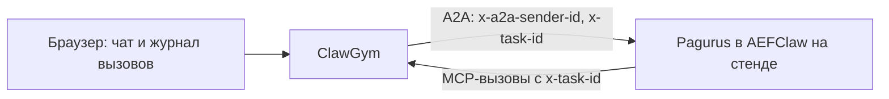

# ClawGym MVP: чат с агентом на заглушках

> Копия от 26 октября 2026 года для репозитория ClawGym. Оригинал — `plan_start.md` в проекте AEFClaw, sha256 `985fcf652159`. Источник истины — оригинал: копия сама не обновляется.

Уточнение от 21 октября 2026 года: имя агента — **Pagurus**; AEFClaw — платформа его исполнения.

Дата: 15 октября 2026 года.
Заказчик: владелец проекта AEFClaw.
Исполнитель: агент разработки с доступом к коду Java-оркестратора.
Полный план развития — `plan.md`. Этот файл — первая версия: только то, что нужно, чтобы поговорить с агентом.

Дата обновления: 26 октября 2026 года. Источник уточнений: требования и ответы владельца в этом чате. Подробная целевая функциональность и задачи — [gap.md](gap.md); этот документ сохраняет отдельный этап ручного чата.

- Любой кейс запускается вручную с его заглушками и общим эталоном, без файла автоматического решения. Перед каждым кейсом обязателен `/reset`.
- Настройки сначала в файлах; редакторы следующим этапом. Автоматический LLM-оператор, два типа корзин, раздельные модели агента и оператора и встроенные метрики относятся к полному плану.
- Целевой прогон выбирает версию прикладных скиллов и получает её изолированную рабочую копию. Комплект обучения и общие правила определяются версией агента. Обучение сохраняет новую версию вместо перезаписи исходной; сохранение результата от вручную вызванного curator требует явного правила реализации.
- Выбор и подготовка прикладного набора расширяют этот ручной этап по задачам MAN-01 и SK-01–03 в `gap.md`. До реализации и проверки установки наборов режим со стартовыми скиллами сборки является промежуточным, а не выполнением полного требования выбора знаний. Поддержка установки на стенде пока не подтверждена.
- Статус на 26 октября 2026 года: ручной режим реализован в репозитории `clawgym/` вместе с первой автоматической версией и проверен только офлайн, на `dev/fake-agent`. На стенде не проверен; этап «Контракты» не выполнен, форматы условные (`clawgym/docs/CONTRACTS.md`).

## Зачем

Сейчас, чтобы пообщаться с агентом, нужно поднимать SmartCare и оркестратор и готовить данные в их системах. MVP заменяет это одним приложением: **чат с агентом Pagurus на тестовом стенде**, где все MCP-инструменты отвечают заглушками. В чате видно, что агент вызывает, с какими аргументами и что получает в ответ.

## Как работать

- Все форматы брать **из кода оркестратора** со ссылкой `путь/Файл.java:строка`. Ничего не придумывать: агент должен видеть то же, что от настоящего оркестратора, иначе наблюдения в чате не переносятся на ПРОМ.
- Если по коду что-то не установить, записать вопрос владельцу в `docs/CONTRACTS.md` и не угадывать.
- Делать только то, что описано здесь. При этом код и форматы закладывать совместимыми с `plan.md`: структура проекта, формат обращения, привязка по `x-task-id`. Тогда дальше можно расти без переписывания. Если `plan.md` доступен, разделы 4–6 полезны как контекст.
- В конце — короткий отчёт: что сделано, как проверено, что не получилось.

## Как это устроено на ПРОМе

Оператор работает в SmartCare и открывает чат с агентом. Чат передаёт сообщения в Java-оркестратор. Оркестратор вызывает агента Pagurus в AEFClaw по REST/A2A и сам является для него MCP-сервером. Инструменты дают сведения об обращении и клиенте и выполняют действия: закрыть, отложить обращение, завести экспертизу (запрос в другое подразделение).

Вызовы, требующие подтверждения, оркестратор удерживает и показывает оператору. Агент в это время ждёт ответа на вызов. Отклонение возвращает агенту ошибку. Служебные команды `/reset`, `/case-capture`, `/skill-curator` оркестратор отправляет в тот же диалог.

## Что уже известно (владелец)

- `x-task-id` передаётся при каждом запросе к агенту, и агент передаёт его в каждом вызове MCP-инструмента. По нему вызов связывается с сессией.
- Новый `x-a2a-sender-id` создаёт на агенте новую сессию со стартовым набором skills.
- Подтверждения удерживает MCP-сервер.
- MCP агента на стенде можно направить на ClawGym. Таймаут MCP-вызова настраивается на стороне агента.
- Стенд выдерживает 2–3 одновременные сессии.

## Что делает MVP



1. **Сессия.** Новый тестовый оператор со сгенерированным `x-a2a-sender-id` или существующий по введённому идентификатору.
2. **Обращение.** Пользователь выбирает файл обращения. ClawGym обязательно отправляет `/reset` перед каждым кейсом, дожидается успешного завершения и затем отправляет стартовое сообщение в формате оркестратора. Это повторяет реальную работу (уточнение владельца от 25 октября).
3. **Чат.** Реплики оператора уходят агенту так же, как от оркестратора. Ответ агента показывается потоком, если A2A потоковый. Промежуточные события (статус, вызовы) показываются, если A2A их отдаёт. Пока агент отвечает, ввод заблокирован: у оператора один диалог.
4. **MCP-сервер.** Те же инструменты с теми же описаниями и схемами, что у оркестратора. Ответы берутся из файла обращения.
5. **Подтверждения.** Вызов удерживается. В чате появляется карточка с инструментом и аргументами, кнопками «Подтвердить» и «Отклонить» и обратным отсчётом до таймаута MCP-вызова на стороне агента. «Подтвердить» — агент получает ответ заглушки. «Отклонить» — агент получает ту же ошибку, что от оркестратора.
6. **Вызов без заглушки.** По настройке вызов либо удерживается для ручного ответа, либо сразу получает ошибку. По умолчанию — ручной ответ: в чате карточка с полем для JSON или текста и кнопками «Ответить» и «Вернуть ошибку». Так можно разговаривать с агентом, не готовя все данные заранее. Для введённого ответа UI показывает YAML-фрагмент для файла обращения с кнопкой «Скопировать».
7. **Служебные команды** — кнопки `/reset`, `/case-capture`, `/skill-curator`. Отправляют тот же текст, что оркестратор; ответ агента виден в чате.
8. **Журнал вызовов** рядом с чатом в реальном времени: время, инструмент, аргументы, ответ, откуда взят ответ (заглушка, ручной, ошибка, отклонено, таймаут), длительность. Строка раскрывается в полные аргументы и ответ.
9. **Журнал сессии** сохраняется в JSON-файл и экспортируется. После перезапуска ClawGym прошлые сессии можно открыть и просмотреть.

### Чего нет в MVP

Имитатора оператора, корзин, метрик, политик обучения, доступа к S3, LLM, автоматической сверки контрактов, редактора обращений в UI, входа в UI. Всё это — в `plan.md`.

## Шаг 1. Контракты

Сокращённый этап 0 из `plan.md`. Результат — `docs/CONTRACTS.md` с примерами JSON и ссылками на код, а также файлы в `contracts/`.

1. **Вызов агента по A2A.** Эндпоинт, тело сообщения, заголовки: как `x-a2a-sender-id` формируется из сведений об операторе, когда генерируется `x-task-id` (на сообщение или на обращение), авторизация. Как приходит ответ: синхронно, потоком или через опрос. Таймауты и ошибки.
2. **Стартовое сообщение.** Шаблон и данные → `contracts/start-message.*`. Есть ли строки `Тематика:` и `request_ref:`, как вычисляется `request_ref`.
3. **Реплика оператора.** Уходит ли текст как есть или с добавками.
4. **MCP-сервер.** Транспорт и версия протокола (должны совпадать с ожидаемыми MCP-клиентом AEFClaw), как читается `x-task-id`. Формат результата и ошибки, точный текст ошибки при отклонении.
5. **Инструменты дословно** → `contracts/tools.json`: имя, описание, входная схема, требует ли подтверждения.
6. **Служебные команды**: точный текст с аргументами.
7. **Конфигурация стенда**: что поменять в AEFClaw, чтобы MCP указывал на ClawGym; текущее значение таймаута MCP-вызова.

## Шаг 2. Реализация

### Стек

Как в `plan.md`:

- Node.js LTS (не ниже 20), TypeScript, Fastify.
- MCP-сервер на официальном TypeScript SDK MCP, если его транспорт совпадает с ожидаемым AEFClaw.
- `yaml` и `ajv` для файлов обращений.
- SSE для обновлений в браузере.
- Статический фронт без внешних CDN и шрифтов: стенд в закрытом контуре.
- Docker-образ, `GET /health`. Dockerfile готовит владелец (решение 25 октября 2026 года).

### Структура

Подмножество структуры из `plan.md`:

```
clawgym/
  docs/CONTRACTS.md
  contracts/       tools.json, start-message.*, tool-defaults.yaml
  cases/           обращения *.yaml
  data/            JSON-ответы инструментов
  src/
    a2a/  mcp/  sessions/  cases/  api/
  web/
  dev/fake-agent/
  test/
```

### Конфигурация

| Переменная | Назначение |
| --- | --- |
| `AGENT_URL` | A2A-эндпоинт Pagurus в AEFClaw на стенде |
| `AGENT_ALLOWED_HOSTS` | Белый список хостов агента. При старте приложение отказывается работать с адресом вне списка, чтобы его нельзя было направить на ПРОМ |
| `MCP_PORT` / путь MCP | Куда AEFClaw отправляет MCP-вызовы |
| `SENDER_PREFIX` | Префикс `x-a2a-sender-id` тестовых операторов, например `lab-` |
| `AGENT_MCP_TIMEOUT_MS` | Таймаут MCP-вызова, настроенный в агенте; по нему считается обратный отсчёт |
| `TURN_TIMEOUT_MS` | Таймаут ответа агента на сообщение |
| `UNMATCHED_MODE` | `manual` (по умолчанию) или `error` — что делать с вызовом без заглушки |
| `MAX_PARALLEL_SESSIONS` | Предупреждение при превышении; по умолчанию 3 |
| `CASES_DIR`, `DATA_DIR`, `SESSIONS_DIR` | Каталоги |

### Привязка вызовов

ClawGym хранит соответствие `x-task-id` → сессия. Вызов с неизвестным или отсутствующим `x-task-id` получает ошибку и пишется в общий журнал, видимый в UI.

### Формат обращения

Подмножество формата из `plan.md` (п. 6.1–6.2). Поля полного формата (`sequence`, `effect`, `state`, `reference`, `operator`) MVP не обрабатывает, но валидатор их допускает, чтобы файлы обращений подходили и следующим версиям.

```yaml
id: card-blocked-wrong-pin
title: Карта заблокирована после трёх неверных PIN
topic: "Карты / Блокировка"          # точное название тематики SmartCare

start:                                # поля — по шаблону стартового сообщения оркестратора
  description: >
    Клиент сообщает, что карта перестала работать после того, как он
    несколько раз ввёл PIN в банкомате. Просит разблокировать.
  client: { id: CL-TEST-0001, name: Тестовый Клиент }

tools:                                # имена и аргументы условные — из contracts/tools.json
  get_case_info:
    - result: { file: cases/blocked-wrong-pin.json }
  get_client_operations:
    - when: { clientId: CL-TEST-0001 }
      result: { file: operations/three-wrong-pin.json }
  close_case:
    - result: { json: { status: CLOSED } }
  create_expertise:
    - error: Сервис экспертиз недоступен
```

Правила:

- Ответ ищется сначала в обращении, затем в `contracts/tool-defaults.yaml`, затем применяется `UNMATCHED_MODE`.
- `when` — совпадение подмножества аргументов по равенству. Первое подходящее правило побеждает.
- Ответ — `result` (одно из `json` / `file` относительно `DATA_DIR` / `text`) или `error`; необязательный `delayMs`. Обёртка результата и ошибки — в формате оркестратора из шага 1.
- Шаблоны в строках: `{{start.*}}`, `{{args.*}}`, `{{now}}`.
- Номер обращения, если не задан в `start`, генерируется на каждое обращение: от него вычисляется `request_ref`.
- Кнопка «Перечитать обращения» — без перезапуска приложения.

### UI

Три области, язык — русский:

- **Слева:** новый оператор или существующий по `x-a2a-sender-id`; список активных и прошлых сессий; список обращений; «Начать обращение»; «Перечитать обращения».
- **В центре:** чат; карточки подтверждений и ручных ответов с обратным отсчётом; кнопки служебных команд; поле ввода. Реплика отправляется по Enter (уточнение владельца от 26 октября 2026 года). Служебные команды и их ответы оформлены отдельно от обычных реплик.
- **Справа:** журнал вызовов текущей сессии с раскрытием деталей; экспорт журнала сессии.
- **HTTP-обмены сессии** (уточнение владельца от 26 октября 2026 года): по нажатию видны все REST-взаимодействия «запрос — ответ». Это запросы к агенту и вызовы MCP агентом: заголовки без секретов, тела, статус, время.

## Тесты

- **Unit:** сопоставление `when`, шаблоны, привязка `x-task-id`, валидация обращений.
- **`dev/fake-agent`** строго по `CONTRACTS.md`: принимает A2A, вызывает несколько инструментов с `x-task-id`, в том числе инструмент с подтверждением и инструмент без заглушки. На нём — интеграционные тесты, запускаются офлайн. Он же нужен для разработки UI без стенда.

## Приёмка на стенде

1. Новый оператор, пример обращения: агент получил стартовое сообщение и ответил в чате.
2. Вызовы агента видны в журнале с аргументами и ответами заглушек и привязаны к сессии по `x-task-id`.
3. Инструмент с подтверждением ждёт решения. После подтверждения агент получает ответ заглушки. После отклонения — ту же ошибку, что от оркестратора, и продолжает работу.
4. Вызов без заглушки ждёт ручного ответа; введённый ответ доходит до агента; YAML-фрагмент копируется.
5. `/case-capture` после закрытия обращения: ответ агента виден в чате.
6. Две сессии на разных операторах работают одновременно, вызовы не путаются.
7. После перезапуска ClawGym журналы прошлых сессий открываются.
8. Тесты проходят офлайн.
9. Для каждой реплики, служебной команды и MCP-вызова сессии открываются HTTP-запрос и ответ; авторизация скрыта (уточнение владельца от 26 октября 2026 года).

## Требования

- Только синтетические данные. В репозитории нет секретов, заголовки авторизации в журнале замаскированы.
- Белый список хостов агента проверяется при старте.
- Ошибки агента, таймауты и сбои доставки видны в UI, а не только в логе.
- README: локальный запуск с fake-agent, подключение к стенду, формат обращения с примером.

## Вопрос владельцу

- Репозиторий и способ деплоя на стенд.
